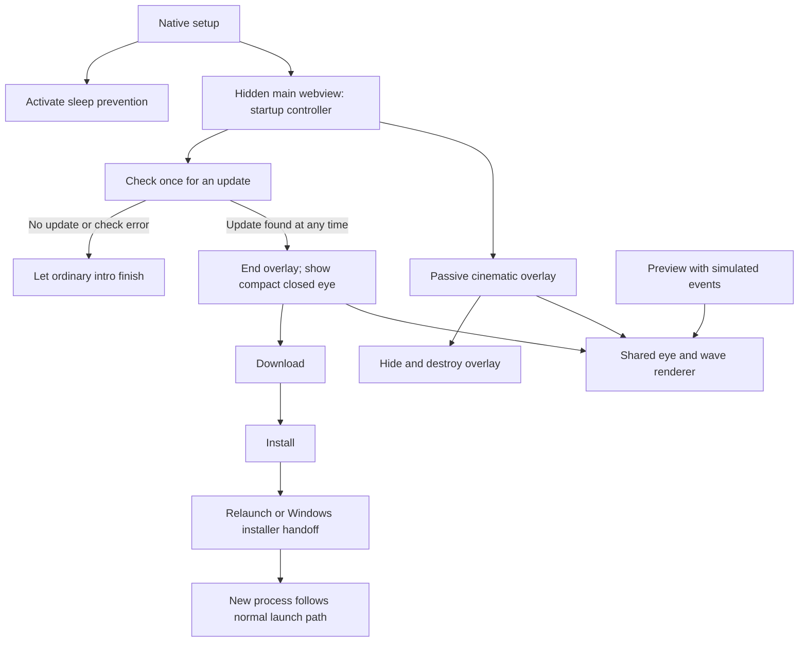

# Awake: cinematic pixel-eye intro and compact update wait

* **Author:** Awake project with Codex
* **Status:** Native startup/update integration implemented; cross-platform and packaged-update acceptance pending
* **Date:** 2026-10-26
* **Updated:** 2026-10-27 — six original findings and portability finding RA-01 addressed; see the
  [resolution report](./goldfish_review_report.md).
* **Context:** [Concept brief](./concepts_brief.md), with the user's confirmed
  every-launch policy, replay preview, screen-sized intro overlay, and compact
  download/install waiting window.

## Implementation progress

Shared motion, browser/native debug replay, production updater coordination,
passive windows, platform compact-show helpers, token/revision guards, and native
deadlines are implemented. The user approved the initial 1750 ms motion in the
browser replay before native integration. See the [preview guide](./docs/startup-preview.md)
for actual local evidence and acceptance still requiring native platform runners.

Implementation refinements preserve the approved boundaries: a pure injected
native bridge and core/event-only port support production and isolated preview;
context commands initialize native revisions on reload; owner-only cancellation
barriers cover pending create replies. One native deadline worker also waits for
Tauri's queued removal before reusing a fixed preview label. The updater owner
flushes the installing label before invoking installation. Merge cleanup separates
registry policy and platform helpers, removes unused symbols and redundant state,
and adds strict unused-code/lint checks plus a three-platform PR workflow.

## Overview

Keep Awake's existing pixel-art identity while making its startup eye feel
more natural. On an ordinary launch, a borderless overlay spans the selected
screen, with the eye centered against a dimmed backdrop with a soft radial
gradient. The eye opens, sends one restrained pixelated shock wave toward the
screen edges, holds briefly, and disappears with the overlay. The full ordinary
sequence lasts 1.5–2 seconds, with 1.75 seconds as the initial tuning target.
The cinematic effect comes from the framing and motion; the eye and wave retain
crisp pixel-art shapes.

Play the intro on every app launch, including the launch after an update.
Sleep prevention starts independently and must not wait for the eye animation
or update work.

A confirmed update uses a compact window rather than the screen-sized overlay.
Throughout download and installation, the eye stays closed with a subtle idle
that suggests it is trying to open but waiting. This waiting state is explicitly
exempt from the ordinary intro's time limit, but it must not cover or dim the
desktop. After installation, preserve the updater's automatic restart; the
restarted app plays the screen-sized opening sequence. The old process does not
add an opening before restarting.

Provide a replay preview at the actual presentation sizes: the screen-sized
opening and the compact waiting window. Tune the opening, shock wave, radial
backdrop, waiting idle, and disappearance before visual acceptance. Preview must
simulate update states without checking for updates, downloading, installing,
restarting the app, or changing sleep-prevention state.

## The Problem

The current eye uses coarse pixel shapes and largely linear motion. Some
details appear abruptly, and simply extending the animation would not make
the opening feel natural. Replacing the art with smooth vector shapes would
also conflict with the app and tray icon's pixel-art theme.

The current splash also waits for the updater and then adds a delay before
hiding on no-update/error paths. Its visibility is therefore not a deliberate
short intro. One fixed dismissal timer cannot satisfy both the short ordinary
launch and the newly requested visible download/install wait.

The current compact, opaque splash does not provide the requested screen-wide
framing or a dimmed view of the desktop. Extending the new cinematic backdrop
through a long update would obstruct the desktop, so the short intro and update
wait require distinct presentation sizes and backdrop behavior.

These two states must be visually distinct without implying that the eye
controls whether Awake is active. A repeating waiting motion must remain
quiet enough to watch during a longer download and must not imply actual
download progress or keep waiting indefinitely after a failure. The eye's
naturalness and the wave's visual weight need an animated preview; source
inspection alone cannot establish them.

## Goals

- Preserve the recognizable eye silhouette, open pose, crisp pixel geometry,
  and monochrome appearance. Center the eye within the selected screen without
  stretching it to fill the backdrop. Keep the tray icons unchanged.
- Present the ordinary intro in a borderless, screen-sized overlay, targeting
  desktop dimming with a soft radial gradient around the eye. The pixel eye
  and wave remain visually distinct from the soft backdrop.
- Play an eased opening, a secondary outward pixelated shock wave, a short
  open-eye hold, and disappearance on every ordinary app launch. Keep the full
  visible ordinary sequence within 1.5–2 seconds under normal foreground
  playback; this does not include process or webview initialization time.
  Remove the overlay and dimming completely when the intro ends.
- Keep the eye closed throughout a confirmed update's download and
  installation. Use a restrained, repeating attempt-to-open idle without a
  full opening or shock wave. Use a compact window, with 300×300 as the current
  size baseline; do not retain a screen-sized dimming layer while waiting.
  This compact waiting state may exceed two seconds.
- Retain automatic restart after a successful update, then play the ordinary
  opening on the restarted app launch. Do not delay restarting to complete a
  cosmetic animation in the old process.
- Start sleep prevention independently of presentation. Keep tray and timer
  behavior available while an intro or update-wait state is visible.
- Provide a replay preview for the screen-sized intro and compact simulated
  update wait, including the restart-to-opening transition. Tune eye size,
  opening timing, wave reach/strength, radial dimming, idle motion, and the exit
  at their actual display sizes before finalizing the visuals.
- Honor reduced-motion preferences, avoid flashing, and stop obsolete visual
  work when a sequence ends, a state changes, or the view is torn down.
- Define recovery from failed checks, downloads, installation, and restart so
  a closed eye does not remain an unexplained permanent waiting screen.

## Non-Goals

- Redesigning the eye into a different visual style, changing tray icons, or
  stretching its pixels to make room for the shock wave. The larger backdrop
  does not require a larger eye.
- Keeping a screen-sized overlay or desktop dimming visible throughout an
  update, or changing the compact timer window into a screen-sized view.
- Adding an animation framework, generic effects engine, cloud telemetry, or
  a persistent animation-settings system.
- Replacing the updater, changing its release endpoint/signature verification,
  or turning the visual preview into an updater test that performs real work.
- Playing only after installation, tracking launch counts, or adding a
  first-run-only preference. The agreed policy is every app launch.
- Treating animation completion or the open-eye pose as evidence of successful
  native activation, completed download progress, or a successful installation.

## Open Questions

All design sections, including Detailed Implementation, are approved,
including the Windows installer handoff limitation. On Windows the closed-eye display ends when Awake
exits into its external installer; macOS/Linux retain it until relaunch. This is
an accepted platform boundary, not an unresolved scope question.

The remaining checks and visual decisions are:

- **Native presentation checks:** transparency, click-through behavior, stacking,
  and monitor placement need real desktop validation, especially under Linux
  compositors. The fallback must never be an opaque screen-sized window.
- **Visual acceptance:** the opening curve, eye scale, wave strength, idle motion,
  and dimming values are starting values for replay tuning, not finalized art.

## Critical User Journeys

| Journey | Given / when | Expected result |
| --- | --- | --- |
| Ordinary launch | The app starts and no update is found, or its check is still pending. | Awake activates independently. One cinematic intro ends within 1.5–2 seconds, then the desktop is undimmed. A slow check does not extend the intro. |
| Update found during the intro | An update is confirmed while the opening is playing. | Remove the cinematic overlay, prepare the compact closed eye, then start the download. Do not finish an opening before downloading. |
| Update found after the intro | A delayed check finds an update after the overlay has disappeared. | Show only the compact closed-eye window before downloading. Do not replay the cinematic intro in the old process. |
| Successful update | Download and installation complete. | The compact eye remains closed until relaunch or the platform's installer handoff. The restarted app runs its normal launch path, including the opening unless another update is found. |
| Update fails | Download, installation, or restart rejects. | Stop the waiting idle, show a concise error in the compact window, and retain a Hide action. Do not imply that an update is still progressing. |
| Replay tuning | The developer opens the preview and replays an intro or simulated update transition. | The shared visuals run with editable tuning values. No real updater, relaunch, activation, or timer operation is called. |

## Technical Plan (Architecture)

### 1. Keep the update owner separate from the cinematic window

Retain the existing `main` webview as the compact update window and the sole
owner of the production update flow. Create it hidden at startup rather than
showing its current black square. It stays alive when hidden so its update
promises retain their execution context. Native `AppState::new()` continues to
activate NoSleep during setup; presentation never changes that ordering.

Use one additional, short-lived `startup-intro` webview for the transparent
cinematic overlay. It only renders the eye, backdrop, and wave. It has no update,
process-relaunch, sleep-prevention, or timer responsibilities. Closing it does
not stop update work in `main`. The existing `timer` window is unchanged.

Separate windows add a small coordination boundary, but avoid resizing a live
update owner between monitor-sized and compact geometry. They also let an old
intro deadline destroy only its own overlay, never the compact update window.



### 2. Component boundaries

These are proposed components and locations; the later implementation section
will enumerate the complete file changes.

| Component | Responsibility |
| --- | --- |
| `src/lib/startup/controller.ts` | A small TypeScript controller for launch/update events, presentation choices, and cancellation. Takes an injected clock, update driver, and presentation driver so preview can use substitutes. No framework or state-machine dependency. |
| `src/lib/startup/StartupVisual.svelte` | Shared visual surface for opening, closed-eye idle, static reduced-motion poses, and error presentation. Does not import updater, process, or sleep/timer APIs. |
| `src/routes/eye-splashscreen.ts` | Reuse the canonical pixel artwork and documented controller. Adapt it for transparent eye-only rendering and explicit eased progress while retaining its existing playback/callback contracts. Do not duplicate the art for preview. |
| `src/lib/startup/tauri-driver.ts` | Production window/update adapter, imported only by the real startup route. Maps updater results to controller events and owns the update resource. |
| `src/routes/+page.svelte` | Mounts the production controller in `main`; renders compact waiting/error UI when needed. Starts one check independently of visual setup success. |
| `src/routes/intro/+page.svelte` | Passive overlay route. Receives its run configuration, prepares a closed pose, reports readiness, and renders the short sequence. |
| `src/routes/preview/+page.svelte` | Replay controls and simulated update events using the same controller/visuals. A browser preview is independent of Tauri. |
| `src-tauri/src/startup_presentation.rs`, integrated by `src-tauri/src/lib.rs` | Native window placement, visibility, caller checks, overlay run tokens, and the short overlay watchdog. Existing sleep and timer state remain separate. |
| `src-tauri/tauri.conf.json` and capability files | Keep `main` compact and initially hidden; give the passive overlay only the permissions it needs. Native preview commands are debug-only. |

Keep presentation state small: the current visual mode, current update phase,
and active overlay run token. Update phases are `checking`, `no-update`,
`downloading`, `installing`, `restarting`, and `failed`. Visual modes are
`preparing`, `cinematic`, `compact-intro`, `compact-wait`, `compact-error`,
and `hidden`. A monotonically changing presentation revision and native-issued
run tokens reject callbacks or commands from obsolete presentations.
No new persistent settings or launch counters are needed.

### 3. Native overlay and monitor policy

At launch, choose the monitor containing the cursor. Fall back to the primary
monitor if the cursor lookup fails. If neither can be identified, skip the
cinematic surface rather than guessing a screen-sized rectangle. The compact
update window can still use its existing centered presentation.

Create `startup-intro` hidden, borderless, transparent, without a shadow or taskbar
entry, always on top, unfocused, and non-focusable. Enable cursor-event ignoring
before showing it. Use the chosen monitor's full physical bounds, including its
possibly negative origin; do not mix those values with logical CSS coordinates.
Do not use exclusive native fullscreen or move the user to another macOS Space.
Do not create an overlay on every monitor.

The webview root must also be transparent. Compose desktop dimming with a CSS
radial black gradient; do not capture the desktop, request screen-recording
access, or add blur/vibrancy. Preserve the eye's crisp pixel edges independently
of the soft backdrop. The previous opaque black artwork background must not
leave a square behind the eye in this surface.

The installed Tauri 2.12.5 window API supports transparency, monitor lookup,
physical positioning, and cursor-event ignoring. Its bundled schema says
`macOSPrivateApi` is a no-op since 2.12.1, consistent with the upstream change;
this plan does not add that flag or a `macos-private-api` feature. Windows offers
`noRedirectionBitmap` to reduce transparent-window creation flashes. Native
appearance still needs testing rather than inference from API availability.

Only show the overlay after its closed pose and backdrop are ready. Readiness
uses a Svelte DOM flush, not an animation frame that a hidden webview may never
deliver. Start the
normal 1.75-second timeline when showing it, not while the route loads. A native
watchdog targets removal at two seconds after showing and applies only to this
run of `startup-intro`. It never hides `main`. Initialize macOS Accessory
activation policy during native setup so the hidden owner does not require a
Dock presence. Main-thread stalls or OS suspension can delay any UI operation; the timing target is for normal foreground playback.

On completion, update discovery, a tray click, or unexpected monitor/scale
change, cancel the active run and remove the overlay. A tray click then performs
its existing toggle/menu action; no extra production menu item is needed. A stale
completion is a no-op. If creation, placement, transparency, or readiness fails,
leave the desktop undimmed, log the failure, and continue activation/update work.
Do not substitute an opaque full-screen background.

### 4. Presentation handoff contracts

Keep native window operations serialized on the main thread and release managed
state locks before those operations. Proposed commands return actual success or
an error; they must not repeat the current pattern of silently ignoring hide
errors for the cinematic handoff.

| Proposed command | Caller and behavior |
| --- | --- |
| `start_intro` | `main` only. Allocates a run token and prepares the hidden overlay with monitor bounds and tuning configuration. A cancelled run cannot later become visible. |
| `intro_config` | The matching overlay only. Reads its native-owned geometry/tuning configuration before first-pose preparation. The route gets only an opaque run token in its URL; an obsolete token cannot obtain a visible run. |
| `intro_ready` | The matching `startup-intro` only. Confirms that the configured first pose is prepared; shows the current run, arms its native watchdog, and acknowledges the timeline start. |
| `finish_intro` | `main` or the matching overlay. Idempotently invalidates and hides/destroys only that run. |
| `show_compact` | `main` only, with an explicit intro/wait/error kind and fresh presentation token. First removes any production overlay, then shows the compact window without desktop dimming, fullscreen sizing, or automatic focus stealing. |
| `hide_compact` | `main` only, with the expected presentation token. An obsolete compact-intro deadline cannot hide a newer waiting/error state. Hiding preserves the update owner and task. |
| `preview_context` / `preview_present` / `preview_control` | Debug builds and the preview controller window only. Discover availability, prepare preview-labelled windows, and forward playback/tuning controls; never call the updater or mutate Awake state. |
| `preview_ready` | Debug builds and the matching preview surface only. Uses the same prepare/configure/show handshake without gaining access to a production run. |
| `preview_sample` / `preview_finish` | Debug builds only. The matching surface can report preview time or finish its own run; the controller can finish that run too. Neither caller can affect production windows. |

Production `main` retains its existing desktop updater/process permissions.
The overlay and preview surfaces do not receive them. Explicit caller-label and
run-token validation in the native presentation commands complements capability
files; a frontend-supplied `preview` boolean is not authorization. Existing
application mutation/window commands must also reject overlay and preview
callers while preserving the current `main`/`timer` call sites. Debug preview
surfaces may read only their own run configuration. Cancel and destroy an
unready hidden overlay after a two-second preparation timeout; this timeout is
separate from the visible-run watchdog and never delays update work.

Before calling `download`, switch the compact DOM to its closed pose and await
the native handoff plus a best-effort visible frame, with a 50 ms maximum
paint wait. Never wait on a hidden animation frame before showing the window. If the overlay is already hidden, this
is simply a compact-window show. If presentation setup fails, keep attempting to
remove any dimming surface and allow updater work to continue; do not strand
an update because decorative UI failed. The native watchdog remains a backstop
for a stale overlay, not a timer for the update window.

Closing/hiding `main` during an update hides its presentation only; it does not
cancel or restart the update. Stop its idle rendering while hidden. Preserve
existing main/timer close behavior, and handle overlay/preview window lifetimes
explicitly rather than applying the current blanket non-timer close rule.

### 5. Ordinary intro and waiting motion

Use one elapsed-time timeline for the eye, wave, backdrop, and exit. Apply a real
progress curve or timed pixel poses; changing the existing `easing` strings
alone does not implement easing. Do not run an independent legacy playback
loop and a competing outer animation loop over the same eye.

| Time from visible start | Initial tuning value |
| --- | --- |
| 0–120 ms | Bring in the dimmed radial backdrop while the closed eye starts waking. |
| 0–850 ms | Ease the eye toward its existing open pose. |
| 200–850 ms | Send one sparse stepped circular wave outward, reaching the selected screen's corners by the end of opening. |
| 850–1450 ms | Hold the open eye. |
| 1450–1750 ms | Fade the entire visual surface, including dimming, to transparency; then remove the native overlay. |

Start with the eye's current nominal 240×240 CSS-pixel canvas, giving 15-pixel
cells from its 16×16 art. Keep it centered without stretching to monitor size.
Preview may tune an integer cell size, but the eye's proportions and open pose
remain the reference. Initial radial dimming uses black at about 55% opacity
near the eye, falling toward about 30% at the outer screen. Wave opacity starts
around 25%. These are audition values, not approved final colors or strengths.

The wave uses a bounded reusable pool of pixel cells, with an initial cap of
256 cells. Sample a stepped contour rather than scanning or rebuilding a
screen-sized pixel grid each frame. Share the eye's visual grid, adjust sampling
stride on larger displays, and reuse nodes. Verify actual cost at Retina/4K
sizes; do not claim a frame rate from this budget alone.

The compact idle proposes one small attempt every 2.4 seconds: a slight lid
twitch, no more than one source-pixel row, returning to the closed pose and then
resting. It never shows the fully open pose, sends a wave, pulses the desktop,
or pretends to represent percentage completion. Stop it at failure or process
handoff. The compact window stays 300×300 with its own local background.

For reduced motion, omit lid travel, the wave, and desktop dimming. Use a
250 ms static open-eye `compact-intro` for ordinary launch, with its own guarded
dismissal token, and a static closed eye during update waiting. This is an
explicit accessibility exception to the cinematic sequence; the update mechanism stays unchanged.

### 6. Update transitions and failure handling

Begin the update check once, concurrently with intro preparation, with a proposed
10-second check timeout. A pending check never extends the cinematic deadline.
No update or a failed/offline check lets the ordinary intro finish and remains
hidden afterward. Log check failures without reopening a window just to report
an unavailable check.

When an update is found, it takes presentation priority at any point. Cancel the
intro and enter the compact closed-eye state before starting the download. If
it arrives after the intro, reopen only the compact window. The old process
does not play another opening or shock wave. App usage and native sleep state
remain independent.

Use the installed updater's supported `download` followed by `install` methods
instead of the combined `downloadAndInstall`, so the UI has an honest boundary
between downloading and installing. Both methods are already in the existing
`updater:default` permission set. Keep the configured endpoint, signatures,
version comparison, artifact handling, and automatic update behavior.

A download `Finished` event is not installation success. Switch to `installing`
only after `download` resolves, render that state, and then invoke `install`.
Show progress only when real byte counts and a total are available; otherwise
show a phase label. Avoid a short download/install timeout borrowed from the
intro: a legitimate update may take minutes. If no download progress arrives
for 60 seconds, change the status to indicate it is still waiting, without
inventing progress or forcibly interrupting installation. The user can hide the
compact window while the update continues.

On macOS/Linux, keep the closed eye through installation and call the existing
process `relaunch` once after success. The installed updater on Windows exits
Awake when handing off to its installer, which is responsible for restarting it;
the old Awake eye cannot remain visible during the external installer. Keep the
closed eye until handoff, preserve the plugin's restart-after-install default,
and show the opening in the new process. Full installer-spanning eye animation
on Windows would require an additional process and is not proposed here.

| Event | Presentation and action |
| --- | --- |
| No update / check error | Finish the ordinary intro if active; otherwise remain hidden. |
| Update found, early or late | Remove overlay, show closed compact eye, then download. |
| Download complete | Remain closed; change the phase label and invoke installation. |
| Installation succeeds | Remain closed until relaunch or installer handoff. Do not add an opening in the old process. |
| Download fails | Stop idle; show a compact error with Hide and Try again. An explicit retry closes the failed update resource and starts a new check/download attempt without replaying the intro. |
| Installation fails | Stop idle; show a compact installation error with Hide. Do not retry a potentially partial installation automatically. |
| Relaunch fails | Stop idle; show that installation finished but restart is still needed, with Hide and an explicit Restart action. |
| User hides the compact window | Hide only the UI, stop idle frames, and retain the existing update task. |

Failures are separate from progress. Do not label a completed or failed update
as still downloading. Release update resources after a completed non-exiting
flow or abandoned failed attempt, and keep one in-flight attempt at a time.

### 7. Replay preview and transition tuning

Add a `/preview` development page and a debug tray action named `Intro Preview`.
The tray action opens a separate `startup-preview` controller window; it must
not remount the production startup route or rerun its update check. The preview
imports the shared controller/visuals with a simulated update driver, never the
production updater adapter.

Browser preview shows a stage that can fit the viewport and clearly labels any
scaling. Native debug preview can show a true monitor-sized overlay and a compact
waiting surface using preview-only window labels. Its controller window remains
available for Replay and Stop. Native Escape handling belongs to that focused
preview controller; the production overlay captures no keyboard or mouse input.

Controls are limited to this task: Replay, Pause/Resume, Stop, Reset, a timeline
scrubber, reduced-motion and wave toggles, plus opening/hold/exit duration, wave
strength/onset, radial dimming, eye cell size, and idle cadence. Constrain normal
total timing to 1500–2000 ms and require the wave to finish during opening.
Tuning is local to preview; accepted values become versioned defaults later,
not persistent end-user settings.

Provide simulated scenarios for no update, slow check, update found during the
opening, update found after hiding, long download, installation, restart, and
each failure. `Finish download` advances to installing while the eye stays
closed. `Finish install / simulate restart` ends the old compact state and starts
a new simulated launch with the cinematic opening. It never calls `relaunch`,
installation, or an activation/timer command. Replay cancels every prior visual
run before starting another; Stop removes all preview dimming surfaces.

### 8. Lifetime and acceptance boundaries

Use a synchronous component mount hook to register cleanup while starting async
update work separately. The production `main` webview remains the update owner
when hidden. Visual completion destroys only the passive overlay. Cancel its
animation frames, fallback timers, listeners, and references when it ends.
Replace a waiting idle rather than accumulating another loop on each state
change. Dismissal and late callbacks are idempotent and token-checked.

Acceptance must include a true native preview: desktop-visible transparency,
correct monitor/DPI positioning, no focus stealing or intercepted clicks, no
opaque creation flash, a fully undimmed desktop after completion, and no lingering
visual frame loop. Test the early-update and late-update handoffs, actual update
continuation while the UI is hidden, reduced motion, failure/retry, monitor loss,
and Windows installer ownership. Browser replay validates visual timing and
simulated transitions; it does not prove native window or updater behavior.

If a platform/compositor cannot support the transparent, non-intercepting overlay,
use a compact ordinary intro rather than obstructing the desktop. Treat that as
an explicit compatibility fallback to verify, not a claim of identical visuals
on every supported OS.

### Technical References

- Current application sources: [startup page](./src/routes/+page.svelte),
  [eye renderer](./src/routes/eye-splashscreen.ts),
  [native runtime](./src-tauri/src/lib.rs), and
  [Tauri configuration](./src-tauri/tauri.conf.json).
- The installed Tauri 2.12.5 Rust sources and CLI schema were inspected for
  transparency, monitor queries, physical geometry, focus, and cursor-event
  handling. Upstream [2.12.1 change notes](https://github.com/tauri-apps/tauri/blob/dev/packages/api/CHANGELOG.md)
  confirm that the former macOS private-API flag is no longer required.
- Installed updater 2.14.0 declarations and implementation confirm the separate
  download/install API and phase events; [official updater documentation](https://tauri.app/reference/javascript/updater/)
  describes the Windows installer exit versus macOS/Linux relaunch boundary.

## Alternatives Considered

These alternatives explain the choices in the approved Technical Plan. The
selected approach is a short-lived cinematic overlay, a separate compact update
owner, shared pixel visuals, and an isolated replay preview. Visual tuning still
needs the actual preview; these tradeoffs do not establish that the animation
already looks natural.

### A. Resize one window between cinematic and compact modes

- **Pros:** Reuses one webview and needs fewer cross-window messages.
- **Cons:** The same window would own update promises, monitor-sized geometry,
  input behavior, and compact waiting UI. A late intro completion or a failed
  resize could affect the live update window. Transition code must also prevent
  an opaque compact background from briefly filling the screen.
- **Reason for rejection:** Separate lifetimes make the critical boundary
  easier to maintain: an intro timeout can remove only the overlay. A single
  resized window is viable in principle, but its smaller window count does not
  offset the additional coupling for this design.

### B. Keep every presentation inside the existing compact splash

- **Pros:** Avoids new monitor placement, desktop transparency, and overlay
  lifetime handling. It is the smaller native change.
- **Cons:** The wave would stop at the compact window and could not provide the
  approved screen-wide framing or radial desktop dimming.
- **Reason for rejection:** It does not meet the selected cinematic direction.
  Keep compact presentation for update waiting, reduced motion, and an explicit
  fallback when the overlay cannot be presented without obstructing the desktop.

### C. Use exclusive native fullscreen or cover every monitor

- **Pros:** Lets the OS manage a fullscreen surface, or gives the effect more
  visible area on a multi-display setup.
- **Cons:** It changes the user's desktop context beyond a short decorative
  overlay and introduces focus/workspace behavior that is unrelated to the eye
  animation. Covering extra monitors expands that interruption.
- **Reason for rejection:** Use a borderless overlay on the selected monitor's
  bounds, on the current workspace, without exclusive fullscreen, keyboard
  capture, or automatic focus changes. Other displays remain unaffected.

### D. Make update completion control the cinematic splash duration

- **Pros:** Gives startup a simple linear sequence: wait for update work, then
  finish the animation and hide.
- **Cons:** A slow check could stretch an ordinary intro beyond two seconds;
  a long download could leave the desktop dimmed for minutes. Holding the
  opening before restart also adds cosmetic delay to a completed update.
- **Reason for rejection:** Ordinary presentation has its own deadline.
  Confirmed download/install work uses the approved compact closed-eye wait.
  An early update interrupts the overlay; a late update opens only the compact
  window. Opening after a successful update belongs to the new process.

### E. Replace the eye with a video, smooth vector redraw, or new animation library

- **Pros:** A purpose-built asset or animation tool could supply polished
  interpolation and reduce the amount of custom motion code.
- **Cons:** A smooth redraw changes the pixel-art identity. A fixed video is
  awkward to adapt to monitor sizes, closed-eye waiting, reduced motion, and
  interactive tuning. A new library adds a dependency without removing the
  need to define the artwork, timings, window handoffs, and update states.
- **Reason for rejection:** Reuse the canonical pixel artwork and existing
  controller contracts, with explicit eased progress and a small shared wave
  renderer. This keeps the motion editable without introducing a general
  animation framework. It still requires preview-based visual acceptance.

### F. Build a separate preview animation or use real updates to replay it

- **Pros:** A standalone mockup is quick to sketch; real update calls would
  exercise some integration behavior directly.
- **Cons:** A copied mockup can drift from the shipped visuals and timing. Real
  update actions make ordinary tuning capable of downloading, installing, or
  restarting the app, and cannot reliably reproduce every timing/failure case.
- **Reason for rejection:** Reuse the production visual/controller modules with
  simulated update and clock drivers. Keep real native presentation checks and
  updater integration verification separate; a simulated preview does not prove
  either one works in production.

### G. Ship only a smoother opening and remove the shock wave

- **Pros:** Gives the eye more visual attention and reduces rendering and
  tuning work. It is a useful comparison when judging whether the wave helps.
- **Cons:** It omits an explicitly requested part of the cinematic concept.
- **Reason for rejection:** Keep one sparse, secondary wave inside the existing
  time budget. Provide a wave-off preview toggle for comparison. If the wave
  cannot remain restrained, return that visual choice to the user rather than
  silently dropping it from the feature.

### H. Keep a helper process alive through the Windows installer

- **Pros:** Could continue showing an Awake-owned closed eye after the main
  process exits into the external installer.
- **Cons:** Adds another executable with its own lifetime, packaging, signing,
  installer coordination, and failure cleanup. That is substantially more work
  than changing a local startup presentation.
- **Reason for rejection:** The Windows handoff limitation is explicitly
  accepted. Preserve the updater's installer/restart behavior and play the
  opening in the restarted application. Do not add a helper solely to retain
  the decorative eye during external installation.

## Detailed Implementation Plan

### Target files and execution order

This is the complete implementation file list. Task numbers identify work;
the phases below define execution order and verification checkpoints. Make the
shared visuals and browser replay usable before connecting real updater
operations. No files are deleted. Create paths shown as code are proposed files;
links point only to files that already exist. Code-formatted file paths are
relative to the repository root.

| Task | File | Action and rationale |
| --- | --- | --- |
| 1 | `tests/startup/fixtures/eye-poses.json` | **Create.** Capture the current closed/open artwork as logical pixel/transform data before changing its renderer. This is the reference for preserving the final open pose, not a newly drawn eye. |
| 2 | `src/lib/startup/types.ts` | **Create.** Define tuning, visual/update states, progress events, the clock, update session, presentation driver, and run identifiers. Use erasable TypeScript with relative `.ts` imports so pure modules also run under Node's built-in test runner. |
| 3 | `src/lib/startup/tuning.ts` | **Create.** Hold one immutable default tuning object and its validation. Production and preview import the same defaults; no local storage or runtime preference file is added. |
| 4 | `src/lib/startup/frame.ts` | **Create.** Pure sampling of eye progress, wave cells, dimming/exit opacity, and the closed-eye idle from elapsed milliseconds. It owns no timers, DOM, Tauri imports, or update operations. |
| 5 | [src/routes/eye-splashscreen.ts](./src/routes/eye-splashscreen.ts) | **Modify.** Preserve public exports, forwarding to shared `pixel-eye.ts` after modularity cleanup; add opt-in startup motion and transparent artwork background. Cache stable SVG nodes instead of clearing all layer children each frame. Preserve legacy defaults and playback/callback semantics. |
| 6 | `src/lib/startup/StartupVisual.svelte` | **Create.** Mount the eye renderer and a reusable bounded wave-cell pool. Consume sampled frames for intro, waiting, reduced-motion, and error poses. Expose visual readiness/completion without importing real update or activation APIs. |
| 7 | `src/lib/startup/controller.ts` | **Create.** Coordinate the approved update/presentation state table with injected drivers and clock. Start at most once, serialize state changes, advance revisions before issuing effects, and ignore obsolete results. |
| 8 | `src/lib/startup/preview-driver.ts` | **Create.** Implement the simulated update session, virtual clock, browser stage, and native-preview presentation adapter through an injected command/event port. It must not import the production update driver, updater/process plugins, or activation/timer commands. |
| 9 | `src/routes/preview/+page.svelte` | **Create.** Build replay/scrub/tuning controls and simulated scenarios. Start in browser-stage mode; offer native replay only when the debug preview context is available. No scenario starts a real check, download, install, or restart. |
| 10 | `src-tauri/src/startup_presentation.rs` | **Create.** Own native presentation records, caller/revision checks, monitor geometry, platform-specific compact show helpers, and bounded watchdog deadlines. Keep macOS, Windows UI-thread activation-guard, and Linux GTK mapping-focus branches behind target configuration in this module. Use standard-library synchronization and one managed deadline worker, separate from NoSleep state. Include portable registry/policy tests and target-specific focus/guard tests here. |
| 11 | [src-tauri/src/lib.rs](./src-tauri/src/lib.rs) | **Modify.** Register the presentation module/state/commands, integrate tray dismissal and close events, and replace the debug Show Splash menu item with Intro Preview. Keep the existing command names as compatibility wrappers, check their callers, and leave sleep/timer transitions intact. |
| 12 | [src-tauri/tauri.conf.json](./src-tauri/tauri.conf.json) | **Modify.** Keep `main` 300×300, borderless, nonresizable, and centered; set `visible: false`, `focus: false`, `skipTaskbar: true`, and `backgroundThrottling: "disabled"`. Build transparent cinematic windows dynamically; do not make `main` monitor-sized or change the timer window. |
| 13 | `src-tauri/capabilities/startup.json` | **Create.** Match only `startup-intro`; grant only `core:event:allow-listen` and `core:event:allow-unlisten` for visual control/cleanup events. New application commands enforce their own caller checks. Do not grant updater/process/opener or broad window mutation permissions. |
| 14 | `src-tauri/capabilities/startup-preview.json` | **Create.** Match only `startup-preview` and `startup-preview-surface`, with the same two event-listening permissions. Native preview creation/control remains debug-only; existing `main` capability files do not gain wildcard labels. |
| 15 | `src/lib/startup/tauri-driver.ts` | **Create.** Adapt the production controller to the updater, process relaunch, and native presentation commands. Own one update resource/attempt and map download events honestly to phases. Keep visual failures from stopping the update task. |
| 16 | [src/routes/+page.svelte](./src/routes/+page.svelte) | **Modify.** Replace the current animation-plus-update mount sequence with one production controller. Start the check independently, render compact states, register synchronous cleanup, and stop visual work on hide without cancelling update work. Remove the unused update status variables in favor of rendered controller state. |
| 17 | `src/routes/intro/+page.svelte` | **Create.** Load validated native run configuration, prepare the transparent first pose, acknowledge readiness, and drive the shared visual timeline. Use the production or debug-preview command namespace selected by native configuration, never a trusted URL boolean. |
| 18 | `tsconfig.startup-tests.json` | **Create.** Type-check the pure startup modules and test files with Node types, strict checking, erasable syntax, and no emit. Extend the project configuration; replace `include` with `tests/startup/**/*.ts`, `src/lib/startup/types.ts`, `tuning.ts`, `frame.ts`, `controller.ts`, `preview-driver.ts`, `native-presentation.ts`, and the pure artwork module `src/routes/eye-splashscreen.ts`. Resolve the abbreviated module names within `src/lib/startup/`. Exclude the production Tauri adapter and Svelte views from this Node test graph. |
| 19 | [package.json](./package.json) | **Modify.** Add `test:startup` using Node's built-in runner and `preview:intro` to open `/preview` with Vite on localhost. Extend `check` to type-check the test project after the existing Svelte check. Add no package dependency. |
| 20 | `tests/startup/helpers.ts` | **Create.** Supply a deterministic clock, deferred update promises, a recording presentation driver, and a fake native command port. Helpers expose pending-work counts and traces for race/lifetime assertions. |
| 21 | `tests/startup/controller.test.ts` | **Create.** Exercise ordinary, early/late update, hidden-wait, failure/retry, stale-effect, and cleanup behavior using the injected drivers. Assert event ordering and exactly-once operations. |
| 22 | `tests/startup/frame.test.ts` | **Create.** Check timeline endpoints, monotonic opening, opacity bounds, wave timing/cell cap, idle closedness, reduced motion, invalid tuning, and different viewport sizes. |
| 23 | `tests/startup/preview.test.ts` | **Create.** Check Replay/Stop/Pause/Resume/seek, every simulated transition, native preview namespace isolation, and disposal. Record zero calls to real update/process/activation/timer ports. |
| 24 | `tests/startup/artwork.test.ts` | **Create.** Compare sampled endpoint artwork against the captured fixture and verify startup interpolation, transparent-background handling, and legacy defaults through the pure artwork sampler. DOM continuity/callback behavior is additionally checked in replay. |
| 25 | `src/lib/README.md` | **Create.** Index the new shared frontend package boundary without duplicating route ownership. |
| 26 | `src/lib/startup/README.md` | **Create.** Document controller/driver interfaces, motion defaults, renderer ownership, revisions, preview isolation, side effects, and verification commands. |
| 27 | `src/routes/intro/README.md` | **Create.** Document passive overlay startup, configuration/readiness/completion IPC, transparent page styling, and teardown. |
| 28 | `src/routes/preview/README.md` | **Create.** Document replay controls, simulated update events, native debug behavior, and how to distinguish browser scaling from actual-size replay. |
| 29 | [README.md](./README.md) | **Modify.** Describe every-launch cinematic presentation, compact update waiting, Windows handoff, and developer preview/test commands. Preserve existing install and tray/timer instructions. |
| 30 | [src/README.md](./src/README.md) | **Modify.** Link shared startup modules and the new route contracts; distinguish the updater owner from passive/preview views. |
| 31 | [src/routes/README.md](./src/routes/README.md) | **Modify.** Replace the current one-second splash/updater description with the new flows and preserve the documented legacy animation API. |
| 32 | [src-tauri/README.md](./src-tauri/README.md) | **Modify.** Explain hidden `main`, transient overlay/preview labels, capabilities, throttling support, and unchanged update configuration. |
| 33 | [src-tauri/src/README.md](./src-tauri/src/README.md) | **Modify.** Document presentation IPC, callers, watchdogs, close/tray behavior, and the separate state boundary; retain existing sleep/timer contracts. |
| 34 | `docs/startup-preview.md` | **Create.** Give replay instructions, scenario checks, native acceptance cases, tuning-result fields, and the Windows installer boundary. Record actual visual/runtime evidence here during implementation rather than marking unrun cases as passed. |
| 35 | [src-tauri/Cargo.toml](./src-tauri/Cargo.toml) | **Modify.** Add target-specific direct dependencies matching the existing lockfile: Linux `gtk = "=0.18.2"`; Windows `windows = "=0.62.2"` with `Win32_Foundation`, `Win32_UI_WindowsAndMessaging`, and `Win32_System_Threading`. These expose Tauri's GTK window traits and the scoped Windows hook APIs without changing Tauri/tao or adding runtime packages on macOS. |
| 36 | [src-tauri/Cargo.lock](./src-tauri/Cargo.lock) | **Modify.** Refresh the root package's direct dependency entries after task 35. Retain the existing locked GTK/Windows/Tauri/tao versions and inspect the diff for unrelated resolution changes; do not hand-edit generated entries. |
| 37 | `src/lib/startup/native-presentation.ts` | **Create.** Pure injected native bridge shared by production and preview. Centralizes token/revision races and fallback behavior so they can be tested without Tauri. |
| 38 | `tests/startup/native-presentation.test.ts` | **Create.** Test readiness-before-reply, cancellation while creation is pending, late cleanup, fallback isolation, and preview-only controls. |
| 39 | `src/lib/startup/tauri-port.ts` | **Create.** Adapt core invoke/event APIs separately from the production updater driver, allowing native preview to import no real updater/process capability. |
| 40 | `src-tauri/src/startup_presentation/registry.rs` | **Create during merge cleanup.** Extract request validation, retained run policy, and portable tests from the native operations module. No native UI operations occur here. |
| 41 | `src-tauri/src/startup_presentation/platform.rs` | **Create during merge cleanup.** Extract the three target-specific compact-show helpers and Windows guard lifecycle. |
| 42 | `src-tauri/src/startup_presentation/README.md` | **Create during merge cleanup.** Document the private policy/platform boundary and verification. |
| 43 | `.github/workflows/check.yml` | **Create during merge preparation.** Run frontend checks/build/tests and native formatting/lints/tests/release checks on macOS, Windows, and Linux for PRs and dev pushes. Do not sign or publish. |
| 44 | `tsconfig.json` | **Modify during merge cleanup.** Reject unused locals/parameters in frontend code and the inherited startup test graph. |
| 45 | `src/lib/startup/pixel-eye.ts` | **Create during modularity cleanup.** Move the single canonical renderer/artwork implementation into the shared library. Keep the old route module as explicit compatibility exports, remove its stale commented-out usage block, and test export identity. Shared visuals no longer depend on route internals. |


Existing `src/routes/+layout.ts`, `src/app.html`, timer files, icon assets,
`pnpm-lock.yaml`, `build.rs`, and release workflows require no changes for this
implementation. Frontend script additions do not require pnpm lockfile
regeneration; the new native direct dependencies do require the Cargo lockfile
update listed above. If implementation reveals another necessary file, update this
list and explain the change rather than silently expanding scope.

### Implementation phases and checkpoints

Each phase must leave the project buildable and its completed behavior testable.
Do not switch the production startup route or hide `main` until Phase 3.

| Phase | Tasks and integration boundary | Required checkpoint |
| --- | --- | --- |
| 1. Shared artwork and motion | Tasks 1–6, 18, 20, 22, and 24. Capture the old art first; add the pure sampler, shared visual, initial helpers, test configuration, and frame/artwork tests. Keep the current startup route using the renderer's legacy defaults. Helpers only depend on modules available in this phase; extend them in Phase 2. | Run the existing `pnpm check`, `pnpm exec tsc --noEmit -p tsconfig.startup-tests.json`, `pnpm build`, and `node --experimental-strip-types --test tests/startup/frame.test.ts tests/startup/artwork.test.ts`. Confirm the legacy startup still renders and fixture endpoints match. |
| 2. Simulated browser replay | Tasks 7–9, 19, 21, and 23; extend task 20. Add the controller, fake drivers, scenarios, browser controls, all four tests, and package scripts. Keep native replay unavailable until its commands exist. Production still uses the current startup route. | Run `pnpm check`, `pnpm test:startup`, and `pnpm build`. Open `/preview`; verify Replay/Pause/seek/Stop, contextual retries, and early/late update scenarios using only simulated effects. |
| 3. Native and production integration | Tasks 10–17 and 35–36. Add the target-specific direct dependencies and refresh the Cargo lockfile with `cargo check --offline --manifest-path src-tauri/Cargo.toml --lib` before locked checks. Inspect the lockfile diff. Add native records, platform show helpers, command guards, capability files, deadline worker, passive route, and production driver before changing the root route and initial `main` visibility together. Enable the debug tray preview only after its handlers and surfaces are connected. | Run all five verification commands below on each release platform's native runner; target-gated branches must compile and their tests must run on that OS. Use the debug desktop app for real-size replay, duplicate-request policy, focus-preserving compact shows, early/late handoffs, and repeated Stop/replay cleanup. Record any unavailable platform checks as pending. |
| 4. Acceptance and documentation | Tasks 25–34. Update contracts and the preview guide for the integrated behavior; record tuning and native/platform evidence. | Repeat the five commands only if later tuning or fixes changed implementation. Complete the native and packaged-update acceptance cases below for each release platform, then obtain visual approval using replay. Documentation must distinguish passed checks from pending ones. |

Put the GTK direct dependency under `target.'cfg(target_os = "linux")'.dependencies`
and the Windows bindings under `target.'cfg(windows)'.dependencies`. Keep their
native imports and implementations behind the matching Rust target conditions;
the macOS build must not compile either platform's APIs.

### Data and timing contracts

`StartupTuning` contains the values below. Reject non-finite inputs and invalid
ranges instead of letting bad values create a stuck visual sequence. Preview
may edit these values in memory; production uses the checked default object.

| Field | Default and validation |
| --- | --- |
| `openingMs`, `holdMs`, `exitMs` | 850, 600, 300. Positive opening/exit and nonnegative hold; the sum must be 1500–2000 ms. |
| `backdropEnterMs` | 120; between zero and `openingMs`. |
| `waveStartMs` | 200; at least zero and at least 100 ms before opening ends. The wave ends with `openingMs`. |
| `introCellPx` | 15 CSS pixels; integer 8–24 CSS pixels. The eye canvas is 16 cells square. Compact presentation uses 15 CSS pixels per cell. Native monitor bounds remain physical pixels. |
| `waveOpacity` | 0.25; range 0–0.4. `waveEnabled` defaults to true. |
| `backdropCenterAlpha`, `backdropEdgeAlpha` | 0.55 and 0.30; each within 0–0.7. This is a black radial gradient, not a captured desktop image. |
| `idleCycleMs`, `idleAmplitudeRows` | 2400 and 0.5; cycle 1800–4000 ms and amplitude 0–1 source-pixel row. |
| Fixed limits | 256 reusable wave cells; 2000 ms hidden-preparation and visible-intro watchdogs; 250 ms reduced-motion compact intro; 10000 ms check timeout; 60000 ms download-stall indication. |

The frame sampler returns eye progress, idle offset, backdrop/whole-surface
opacity, visible wave-cell positions, and completion. It uses elapsed time,
not the number of frames received. Clamp time outside the sequence to endpoint
poses. A skipped frame advances to the current pose rather than replaying old
steps.

Map ordinary opening time to progress with smootherstep: for normalized time
`t`, use `6t^5 - 15t^4 + 10t^3`, then map to the eye's 0–100 progress range.
Startup motion uses shape-preserving cubic interpolation of numeric keyframe
transforms: use endpoint secants, a zero tangent at direction reversals, and
weighted harmonic-mean tangents for adjacent slopes in the same direction.
This removes sharp velocity changes without overshooting the stored poses.
Legacy mode retains its current interpolation. Objects first appearing after
zero progress fade in over the next ten progress points in startup mode only;
this avoids the pupil's current single-frame appearance. Endpoint artwork must
still match the captured open/closed references.

Add only two optional renderer settings: `background: "black" | "transparent"`
and `motion: "legacy" | "startup"`, defaulting to the old black/legacy behavior.
Identify the existing background asset by a named internal role/ID, not by
changing the white eye data. Expand compact/RLE data once. Keep stable layer,
object, and pixel nodes keyed by their data identity; update attributes and
transforms rather than replacing the entire group each frame. Rebuild an
object subtree only when its stored geometry/type actually changes.

The shared visual owns one frame loop. It externally seeks the eye renderer;
it does not also call legacy `play`. Seeking continues to have its current
callback semantics. Ordinary visual completion reports to the presentation
controller separately; it must not invent a legacy callback on seek.

For the wave, expand a stepped circular contour from the eye center to the
viewport's farthest corner over the configured wave interval, using eased
outward travel. Quantize cells to the eye's grid, deduplicate them, and increase
angular sampling stride as needed to remain within the 256-node pool. Fade the
wave near the end of that interval. Never scan or allocate a full viewport grid
per frame.

For waiting, keep eye progress at its closed pose. During each idle cycle,
slightly lift that closed pose over the first 120 ms, settle back by 360 ms,
then rest until the cycle ends. The configured amplitude moves the closed art;
it does not expose the pupil or play part of the normal opening. Reduced motion
sets the offset to zero and disables wave/dimming. These are initial replay
values; accepted visual tuning may adjust defaults within the approved bounds.

### Controller and update ordering

Expose a controller with `start`, `hideWait`, `retryDownload`, `retryRestart`,
`stopPresentation`, and `dispose` operations plus immutable snapshots.
`start` is idempotent. The injected update session exposes `download`, `install`,
`relaunch`, and `close`; the production adapter maps those to the installed
plugin methods. The presentation driver supplies preparation/show/hide operations
and reports visual completion. A fake clock supplies the same timing interface
in tests and browser replay.

Start the check before awaiting any presentation preparation. Catch visual
setup failure separately so it cannot bypass the check. Before download,
advance the presentation revision, cancel the ordinary intro, set the closed
waiting snapshot, and request native compact presentation. Flush its DOM with
Svelte `tick`, show it, and wait for a visible frame for at most 50 ms. A hidden
webview's animation frame must never be a prerequisite for showing it. If the
visual handshake fails, record the failure and continue the update attempt.

Every effect captures its revision. After each asynchronous boundary, compare
that revision with the controller's current one before showing or hiding a
window. Update discovery takes priority over preparation/completion. Progress
callbacks may change labels, not re-show a user-hidden window or restart an
intro. Old intro completion cannot hide waiting, and a late preparation result
cannot make a cancelled overlay visible.

Download must resolve before installation is invoked. Render the installing
phase before invoking `install`; the plugin's download `Finished` event alone
does not trigger restart. After installation resolves, call `relaunch` once.
On Windows, the process exits into the installer before that continuation runs;
native debug simulation models the handoff and a new launch without calling the
real process API.

On download failure, close the failed session before an explicit retry creates
a new check/download attempt. Disable duplicate retry actions while an attempt
is active. Do not automatically retry installation. A restart retry invokes
only relaunch, not check/download/install again. On failure, stop the idle and
show the approved compact error actions if the user has not hidden the wait.
If they have hidden it, retain/log the error without reopening a window.

Hide, preview Stop, and visual completion dispose only presentation work. Hiding `main` does not
unmount it or cancel its update task. On actual component teardown, detach visual
observers and listeners; do not close a resource underneath an in-flight install.
Release its update resource once the attempt has settled, or let process exit
release it after a successful restart/handoff. Preview disposal cancels all of
its simulated promises and clocks.

### Native protocol and window lifetime

Use fixed labels: production `main`, `startup-intro`, and existing `timer`;
debug `startup-preview` and `startup-preview-surface`. The preview surface uses
the passive intro route for cinematic, compact waiting/error, and static poses.
Only native code creates these windows. Because `destroy()` queues removal, the
single deadline worker retries a fixed-label replacement only after the old
window leaves Tauri's manager. It rechecks the token and original preparation
deadline before every attempt; Stop or a newer run invalidates pending work.

Refine the approved commands with these payload rules:

| Command | Inputs and result |
| --- | --- |
| `startup_context` | `main` only; returns the highest production revision so a reloaded owner continues its monotonic sequence. |
| `start_intro` | `main` supplies a monotonic `revision` and validated tuning. Native records the request before preparing the window and returns a decimal-string `runId` plus its presentation status. Apply the revision rules below; duplicate requests never allocate another run. |
| `intro_config` | The passive surface supplies `runId`; native verifies its exact window label and production/preview ownership and returns visual kind, tuning, and mode. A URL carries only the run identifier, never trusted permissions or settings. |
| `intro_ready` | The matching production surface supplies `runId` after DOM preparation. Native shows it only if still current, arms its visible deadline once, and returns `shown` plus elapsed/remaining milliseconds. Duplicate readiness does not restart the clock. |
| `finish_intro` | `main` or the matching surface supplies `runId`. Only `main` may instead send `runId: null` and a higher `revision` as a cancellation barrier while creation is pending. Old tokens cannot advance that barrier or end another run. Repeated completion is a no-op. |
| `show_compact` | `main` supplies `revision` and `kind` (`intro`, `wait`, or `error`). For a new revision, native removes the production overlay first, shows `main` through the nonactivating helper below, and returns a new `compactToken` plus its presentation status. Duplicate requests reuse the recorded token and do not show again. |
| `hide_compact` | `main` supplies the expected `compactToken`, or a null token plus a higher owner cancellation revision. A mismatched token is a no-op and cannot advance the barrier or hide a newer wait/error state. |
| `preview_context` | Debug `startup-preview` only; returns the highest preview revision and no production updater state; successful access establishes native-preview availability. The browser preview does not require it. |
| `preview_present` | Debug controller supplies its preview revision, kind, and tuning. It prepares only `startup-preview-surface`, with a separate token namespace and the same revision rules below. Return its existing token/status for an identical duplicate, without renewing its lease. |
| `preview_ready` | The matching debug surface acknowledges its prepared pose and may show only its own preview run. |
| `preview_control` | Debug controller supplies the preview run and Pause/Resume/Seek or tuning values. Native validates and forwards them only to its matching preview surface. |
| `preview_sample` | The matching preview surface reports its run, elapsed time, and paused state to the controller at no more than ten updates per second. It cannot send production commands. |
| `preview_finish` | Debug controller or matching surface supplies its preview run. Only the controller may use a null token plus a higher cancellation revision. Stop/completion removes only preview surfaces and cancels their deadlines. |

For `start_intro`, `show_compact`, and `preview_present`, use these revision
rules within the production or preview namespace. Keep the highest accepted
revision and its command, validated payload, token, and status until a higher
revision replaces it; ending a presentation must not reset that record.

- A higher revision accepts a new request and allocates one token before
  starting native window work. Status is `preparing`, then `active`, and finally
  `ended` or `failed`. Record a failure's original error as well.
- A lower revision returns `stale_revision` and performs no window operation.
- An equal revision with the same command and validated field values returns
  the existing token and current status. While preparation is pending, return
  `preparing`; do not queue a second creation/show or reset any deadline.
- An equal revision with a different command or payload returns
  `revision_conflict` and performs no window operation. Compare validated
  values, not JSON key order.
- Completion, cancellation, user hide, or deadline expiry leaves status
  `ended`. An identical duplicate then returns that ended token/status without
  resurrecting the presentation. A failed request similarly returns its
  recorded token, `failed` status, and error without retrying native work.
  A deliberate new presentation or retry requires a higher revision.

Callers only treat `preparing`/`active` as a live presentation. Replay allocates
a higher preview revision; Pause/Resume/Seek controls do not allocate revisions
or extend the preview safety lease.

For production, serialize revision changes and window effects on the native main
thread. Recheck the record before showing a window after creation. Restrict
every new command by the actual Tauri-injected caller window. Application
commands are otherwise callable by local webviews by default, so capabilities
alone are not a substitute for these checks. Existing sleep/timer mutators
continue to accept their current `main`/`timer` callers and reject intro/preview
callers. Keep native helpers separate from IPC wrappers so tray callbacks still
invoke their existing behavior without an invented frontend caller.

Prepare the intro with full physical monitor bounds; keep CSS drawing dimensions
in logical pixels. Set transparency, transparent native background, no shadow,
no decorations, no taskbar entry, no focus, and cursor-event ignoring before
show. `main` keeps its compact opaque styling and is not made always-on-top.
Center its first update presentation on the selected launch monitor when
available; preserve that compact position on subsequent error/state changes.

Initial `focus: false` only controls window construction. Dispatch each
hidden-to-visible compact transition to the target-specific helper below, on
the native UI thread. Apply the same branch to `main` and compact preview
surfaces, each with its own run/record. If already visible, update content and
the presentation token without another show. Never call `set_focus` for these
automatic transitions. The interactive preview controller and timer retain
their existing deliberate-focus behavior; cinematic surfaces stay nonfocusable.

**macOS:** Keep the verified synchronous sequence: save prior focusability from
the native record, call `set_focusable(false)`, call Tauri `show()`, then restore
the saved value. Initialize the record from the default focusable setting
(`true`). Do not show if disabling fails. Attempt restoration after either show
success or error. If show/restoration fails, record the last applied value,
hide newly shown UI, and return a presentation error. This branch alone uses
temporary focusability changes.

**Windows:** Keep the compact window focusable and use Tauri `show()` so tao's
visibility flags remain synchronized. Suppress its synchronous activation
attempt with a scoped Win32 `WH_CBT` hook on Awake's current UI thread:

- Obtain the target HWND with `hwnd()` and verify that its owning thread equals
  `GetCurrentThreadId()`. Install `SetWindowsHookExW` with that nonzero thread
  ID, `WH_CBT`, an in-process static callback, and a null module handle. Do not
  install a global hook or inspect another process.
- Store the guarded HWND in UI-thread-local state for this synchronous call.
  Reject a nested guarded show before replacing an active target. The callback
  returns 1 for `HCBT_ACTIVATE` targeting that HWND and for `HCBT_SETFOCUS`
  targeting it or its native descendants (`IsChild`). Negative codes, other
  windows, and all other operations pass to `CallNextHookEx`. The callback
  takes no application-state locks, retains no transient references, and does
  not panic across the native callback boundary.
- Call Tauri `show()` once while the guard is armed; do not await, queue another
  UI closure, or return to the event loop inside this scope. The locked Wry and
  tao implementations execute this show synchronously when already on their
  UI thread. This assumption needs checking when those dependencies change.
- On every exit path, clear the guarded target, then remove the hook with
  `UnhookWindowsHookEx` using a scope guard. After removal, deliberate clicks
  and keyboard interaction work normally. Do not toggle focusability and do
  not substitute direct Win32 visibility calls that leave tao's flags stale.
- Failure to install the hook prevents showing. Show/removal failure returns
  a presentation error and hides newly shown UI. If removal fails, keep the
  callback's target cleared so it forwards every event, retain that hook handle
  for a UI-thread cleanup retry, and refuse another guarded show until cleanup
  succeeds. The callback has static lifetime; it never references disposed
  controller state. Continue updater work throughout visual failures.

**Linux:** Obtain Tauri's `gtk_window()` on the UI thread and use the GTK 0.18.2
window extension traits. Before its first automatic show, set
`set_focus_on_map(false)` and `set_accept_focus(true)`. Keep both values for the
compact window's lifetime and repeat them before each hidden-to-visible show.
Call Tauri `show()` normally. In particular, do not temporarily disable and
immediately restore `accept_focus`: tao queues GTK `show_all()`, so that restore
would run before mapping. The persistent mapping-focus hint covers the queued
show; accepting input focus allows deliberate interaction afterward. Do not
call GTK `present`, restore mapping focus after queuing, or add map/draw handlers
just to time a restoration. GTK/window-manager hints still need real X11 and
Wayland validation. If native handle acquisition/show fails, return the visual
error and continue updater work.

All branches retain the existing revision/cancellation checks and Tauri
hide/destroy lifecycle. Route compatibility `show_splash` through this helper
and remove its explicit focus request; `hide_window` and main-close handling
still hide only the presentation. Hide newly shown compact UI if a later
helper step fails, log cleanup errors, and preserve its update owner. No branch
changes the tray/timer state, updater task, or native dependency implementation.

The passive route fetches configuration, mounts its initial zero-opacity visual,
and awaits `tick` before reporting readiness. It does not await a hidden frame.
After the show acknowledgment, anchor the shared clock using the reported
elapsed time and begin visible sampling. The native deadline remains authoritative
for maximum overlay lifetime. Bind both overlay close and native destroy events
to invalidate that run; ordinary user closing of `main` still hides it.

Use one private deadline worker for preparation, visible intro, and preview
safety deadlines, with standard-library `Mutex`/`Condvar` timed waiting. Notify
it on cancellation/replacement and release its lock before queuing UI work.
Do not spawn a sleeping thread for every preview replay. A cancelled run loses
permission to show immediately, but retain its cleanup record until its actual
window is hidden/destroyed. If hiding fails, attempt destroy; pending cleanup
targets that old handle rather than a newly created window with the same label.

Production has the approved two-second preparation and two-second visible
deadlines. Native preview is not subject to the production two-second deadline
while paused or scrubbed; it has a 30-second absolute safety lease per replay.
Replay starts a fresh lease. Stop, controller closure, completion, or lease
expiry removes preview dimming. Longer paused inspection uses the browser stage,
which cannot leave a native overlay behind.

Configure `main` with `backgroundThrottling: "disabled"` for the hidden update
owner. The installed schema supports this policy on macOS 14+ and does not
support it on Windows/Linux. Do not claim that this setting solves hidden-task
continuation everywhere or add an undocumented WebLock workaround. A download
that finishes after more than five minutes hidden, then installs/restarts,
is a native acceptance case on each platform being released. If a platform
cannot pass, block that platform's release and revisit the owner architecture
explicitly rather than silently changing it or claiming the check passed.

### Replay preview behavior

`preview:intro` runs `vite dev --host 127.0.0.1 --open /preview`. In a browser it
renders a labelled stage with the shared visuals and a virtual clock. The debug
tray action opens `/preview` in `startup-preview`, exposing true-size native
replay through the debug-only command port. Preview controls remain in that
controller window, separate from `startup-preview-surface`.

Replay cancels prior runs and restarts at zero; Pause freezes the visual clock;
Resume continues without a time jump; scrubbing samples the requested timestamp
without triggering update operations or a production hide. Editing tuning
re-samples the current preview state. Reset restores the shared default object.
Stop removes all preview surfaces and returns the stage to idle. Native time
samples update controls without feeding another seek back to the surface.

Provide named scenarios: ordinary/no update; slow check; update at 300 ms;
update after the intro has hidden; long download; installation; download error;
installation error; and restart error. Scenario controls explicitly advance
Download complete, Install complete, Fail, Hide wait, and Simulate restart.
After download failure, show Try again, which calls `retryDownload` to create a
fresh check/download attempt. After restart failure, show Restart, which calls
`retryRestart` to retry only relaunch. Installation failure offers Hide without
a retry action. Keep these labels and permitted actions aligned with production.
Simulate restart disposes the old simulated launch and creates a new one with no
update; it must not simply open the eye in the old waiting state. Simulate the
accepted Windows handoff as ending the old view before the new launch begins.

Only a true native replay can validate desktop transparency, physical monitor
placement, click-through behavior, and compositor flashes. The browser stage
labels its scale and never presents its checkerboard/test background as proof
of desktop dimming. Preview controls are developer tools, not a new production
settings screen. The native command implementations and tray entry are absent
from release builds.

### Verification plan

Add the dependency-free script:

`node --experimental-strip-types --test tests/startup/controller.test.ts tests/startup/frame.test.ts tests/startup/preview.test.ts tests/startup/artwork.test.ts`

Keep source imports in the pure test graph relative and explicitly suffixed
`.ts`; avoid TypeScript syntax that requires runtime transformation. Node's
runner does not type-check, so `check` becomes the existing Svelte check followed
by `tsc --noEmit -p tsconfig.startup-tests.json`. The documented Node minimum
22.17 remains supported through the explicit type-stripping flag; CI Node 24
also supports this path. No new test framework or browser automation dependency
is required.

The automated tests must assert behavior rather than source strings or copies
of the implementation:

| Area | Required assertions |
| --- | --- |
| Ordinary launch | Check starts even if visual preparation rejects; no-update/pending-check presentation finishes at its own deadline; start is idempotent. |
| Early update | At 300 ms, finish/invalidate the intro before showing closed compact content; download follows the bounded visual handoff, not intro completion. |
| Late update | After 1750 ms, show only compact waiting; do not create another production intro. |
| Races | A late start/readiness/completion/hide cannot affect a newer presentation. Duplicate readiness cannot renew the visible deadline. Identical equal-revision requests reuse their token/status without new window work or deadline/lease renewal; conflicting equal revisions fail. Duplicates after completion/cancellation/failure cannot resurrect a presentation. Cover production and preview namespaces. |
| Update ordering | Download resolves before install; download `Finished` alone is insufficient; relaunch is called once after resolved install. Retry restart does not reinstall. |
| Hidden UI | Hiding stops idle frames, not the pending update chain. Progress/error events do not re-show a user-hidden wait. |
| Failure and disposal | Failures stop idle; explicit retries close the old settled resource; no duplicate attempt or frame loop survives Replay/Stop/disposal. |
| Frames/artwork | Endpoint masks match the pre-change fixture; startup samples are finite and bounded; waiting never reveals the open pose/pupil; wave count stays at or below 256 for compact, HD, 4K, and ultrawide viewports. |
| Preview | All simulated scenarios leave real updater/process/activation/timer call traces empty; fake clock pause/seek does not advance real operations. Try again rechecks/downloads, Restart only relaunches, and installation failure exposes no retry. |
| Native policy | Wrong caller/namespace and stale revision/run IDs are rejected; expected-token hide is idempotent; cleanup retains failed old handles; deadlines never target `main` update work. |
| Compact focus: shared | Already-visible content changes skip showing; stale/cancelled requests cannot show. A helper error hides newly shown UI without cancelling the updater task. Compatibility splash commands cannot bypass the helper. |
| Compact focus: macOS | Disable/show/restore stays ordered on the UI thread. Disable failure skips show; show failure still restores; restoration failure hides newly shown UI. |
| Compact focus: Windows | The guard exists only on the target UI thread and blocks activation/focus for its HWND/descendants during synchronous show; other windows/codes are forwarded. Installation failure skips show, nested attempts do not replace the active target, and success/show failure both clear the target and remove the hook. Removal failure leaves a forwarding-only callback and blocks new guarded shows until cleanup. No focusability toggle or out-of-band visibility mutation occurs. |
| Compact focus: Linux | Set mapping focus false and accept focus true before the queued show. Both persist through mapping, hide, and re-show. No immediate restoration or map/draw callback is introduced. |

Run during implementation:

```sh
pnpm check
pnpm test:startup
pnpm build
cargo fmt --manifest-path src-tauri/Cargo.toml -- --check
cargo test --manifest-path src-tauri/Cargo.toml --locked --lib
```

Then use the debug desktop app for actual-size replay and native integration.
Record monitor geometry/scale, OS, durations, visible wave cells, and observed
teardown in `docs/startup-preview.md`. Confirm both a negative-origin monitor
and Retina scaling, ordinary foreground visibility of 1500–2000 ms, no focus
stealing or intercepted clicks, complete removal of dimming, early/late update
handoffs, reduced motion, and repeated replay/stop without accumulating windows,
timers, listeners, or worker threads.

Specifically test a late update with Awake's timer focused and with a different
application focused. The compact window must appear without taking keyboard
focus. Selecting it deliberately afterward must allow mouse and keyboard
controls to work. Run first show, Hide/re-show, waiting-to-error, and compact
preview transitions on macOS, Windows, and Linux. Cover Linux X11 and Wayland
sessions available for release validation. On Windows verify no guard survives
success, failure, or repeated Replay/Stop, and verify Tauri `is_visible()` and
subsequent native geometry/DPI changes agree with the visible window state.

Exercise actual update success/error/relaunch on disposable packaged test builds
before shipping the updater change. Keep the production endpoint/signature
configuration intact; local replay itself remains simulated. Verify long-hidden
completion separately from browser tests. Windows acceptance ends the old eye
at external-installer handoff and checks the new process's opening. A test that
was not run is recorded as unverified, not passed.

Visual tuning proceeds first through browser replay, then through the true-size
native overlay. The user approves the opening, wave, idle, and disappearance
before visual finalization. Only then copy the accepted tuning values into
the default object and record them in the preview guide. Architecture/section
approval does not by itself approve the starting artwork motion or opacity.

### References for implementation contracts

- [Node's native TypeScript guidance](https://nodejs.org/learn/typescript/run-natively)
  covers the explicit flag for versions before 22.18 and distinguishes type
  stripping from type-checking.
- [Tauri capability documentation](https://v2.tauri.app/security/capabilities/)
  distinguishes window/plugin capabilities from application commands, which
  are available to local webviews by default unless restricted.
- The installed Tauri CLI schema and `WebviewWindowBuilder::background_throttling`
  documentation were checked for the hidden-view suspension behavior and the
  macOS-only support boundary described above.
- [Microsoft CBTProc reference](https://learn.microsoft.com/en-us/windows/win32/winmsg/cbtproc),
  [thread-specific hook installation](https://learn.microsoft.com/en-us/windows/win32/api/winuser/nf-winuser-setwindowshookexw),
  and [hook removal](https://learn.microsoft.com/en-us/windows/win32/api/winuser/nf-winuser-unhookwindowshookex)
  define the scoped Windows activation guard. The locked Wry main-thread
  dispatcher and tao thread executor were checked for synchronous execution.
- [GTK mapping focus](https://docs.gtk.org/gtk3/method.Window.set_focus_on_map.html)
  and [input focus acceptance](https://docs.gtk.org/gtk3/method.Window.set_accept_focus.html)
  distinguish automatic mapping from deliberate interaction. Tauri 2.12.5's
  `gtk_window()` exposes the GTK 0.18 window; the existing lockfile resolves
  GTK 0.18.2 and Windows bindings 0.62.2.

*Drafted with EGM. Shared animation and browser replay are implemented. Native
integration, platform validation, and visual acceptance through replay are pending.*
