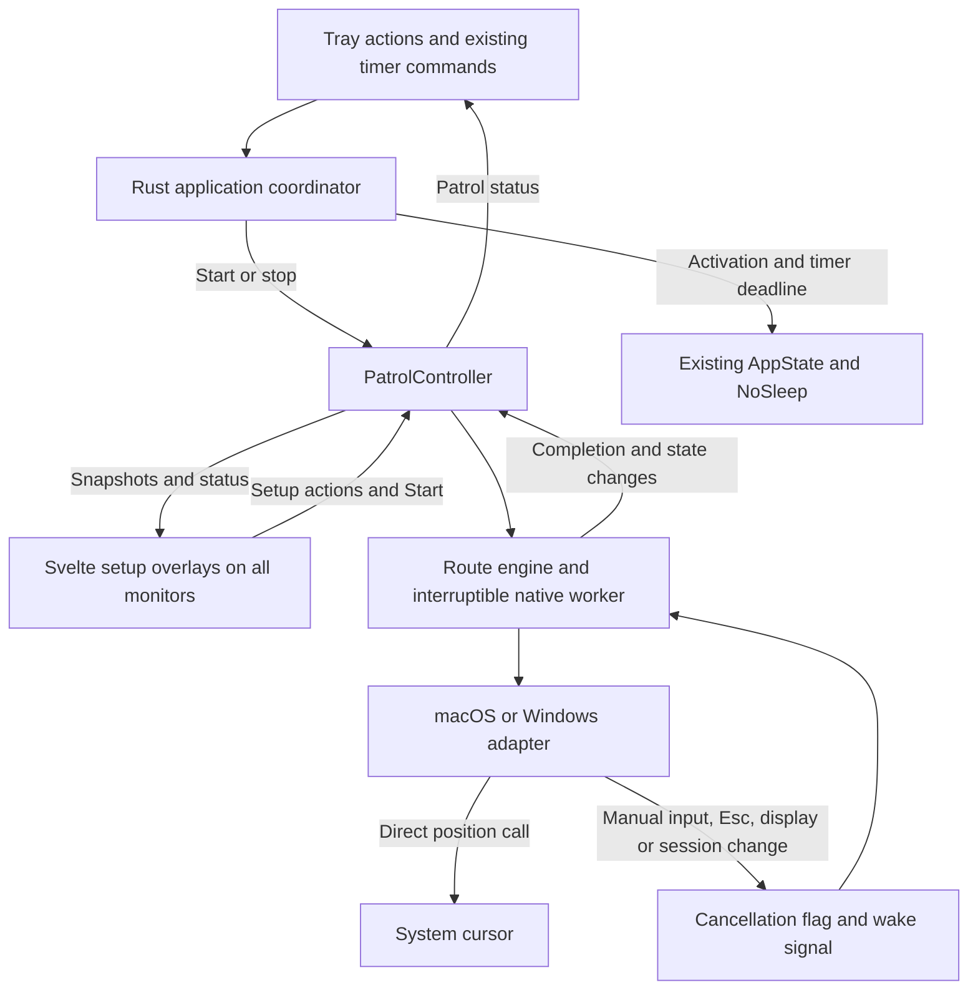

# Awake: cursor patrolling on macOS and Windows

* **Author:** Awake project with Codex
* **Status:** Approved
* **Approval:** All design sections and final integration updates approved on 2026-10-27.
* **Validation:** Phase 0/native desktop verification remains pending; approval covers the gated implementation plan.
* **Date:** 2026-10-26
* **Last updated:** 2026-10-27
* **Context:** [Approved cursor-patrolling concept brief](../cursor-patrolling/concepts_brief.md). The user approved beginning design, including one patrol at a time, preservation of existing timer deadlines, and session-only route retention.

## Overview

Extend Awake with a **Cursor Patrolling** tray-menu option for users who want repeated cursor movement through chosen screen positions alongside sleep prevention. Setup opens overlays on all connected monitors. The user clicks to add at least two points in total, drags points to adjust them, sets a pause interval, and presses **Start**.

One shared route follows the order points were added across all screens. The cursor moves smoothly to each point, pauses there for the configured interval, and continues from the last point back to the first. The interval controls time spent stationary at a point; travel takes additional time.

Patrol starts sleep prevention if necessary and preserves an existing sleep timer's deadline. Esc from any application or manual mouse movement stops patrol immediately while leaving Awake active. Turning Awake off or allowing its timer to expire stops patrol as well. At most one patrol may run, and the route is retained only for the current app session.

The first version targets macOS and Windows. If a monitor disconnects or the display layout changes, patrol stops while Awake stays active. The user must review the route and correct invalid points before explicitly restarting. Linux cursor patrolling is deferred.

## The Problem

Awake currently controls sleep prevention through its tray menu and timer, but it offers no way to select screen positions or repeat cursor movement between them. The new mode provides a direct setup flow and a repeatable route while retaining the existing sleep-prevention controls.

Cursor movement also creates a control problem. The user must be able to reclaim the pointer without first reaching the tray or focusing a setup window. Stopping must interrupt both travel and stationary pauses, and a completed stop must prevent queued movement from taking control again. Patrol's own movement must not be mistaken for manual mouse input.

Multiple monitors add a route-validity problem. Point selection must form one ordered route across all overlays, including screens with different positions or scaling. If the display layout changes, previously chosen points cannot be silently moved or treated as reviewed. Recovery must keep sleep prevention active while returning route decisions to the user.

Patrol and sleep prevention have related but distinct lifetimes. Esc and manual movement stop only patrol; Awake off and timer expiry also stop patrol. An error releasing sleep prevention must not prevent cursor control from being released. The design must make these outcomes clear and preserve ordinary Awake behavior if patrolling cannot start.

## Goals

- Provide a **Cursor Patrolling** tray-menu entry that opens a coordinated setup session on every connected monitor.
- Allow at least two points across the whole route, placed by clicking and adjusted by dragging. Points retain their insertion order across screens. Setup input must not activate applications beneath the overlays.
- Let the user set one pause interval and explicitly start the route. Move smoothly through the points, including the closing segment from last to first, pausing at every point for that interval.
- Enable Awake when starting patrol if needed. Preserve any existing sleep timer deadline rather than resetting or extending it.
- Allow at most one active patrol, including under repeated Start actions. Retain the route within the current app session only.
- Make Esc and manual mouse movement stop patrol from any application while leaving sleep prevention active. Stop during either travel or a pause, without waiting for that phase to finish or automatically resuming afterward.
- Distinguish patrol-generated movement from manual mouse input so patrol neither stops itself nor keeps moving against the user's input.
- Stop patrol when Awake is turned off or its sleep timer expires. Release cursor control even if stopping sleep prevention reports an error.
- Stop patrol on monitor disconnection or display-layout change while leaving Awake active. Require the user to review points, correct invalid locations, and explicitly press Start before movement resumes.
- Prevent queued or newly scheduled patrol movement from executing after a completed stop is acknowledged.
- Support verified patrol behavior on macOS and Windows. Keep the existing sleep-prevention, timer, and tray functions available when patrol support or required permissions are unavailable.

## Non-Goals

The approved first-version boundaries exclude Linux cursor patrolling, simultaneous patrols, routes saved across application launches, and extending an existing sleep timer as a side effect of starting patrol.

This design also excludes automatic clicks, recorded gestures, random routes, per-point pause settings, and multiple named routes from the first version. These exclusions originated as recommendations in the concept brief and are adopted by this plan. The requested feature remains an ordered movement loop with one shared pause interval.

## Open Questions

The approved Technical Plan below defines the product and architecture choices for the next stage. Its native integrations are supported by source/documentation checks, with these release questions still requiring desktop evidence:

- **Native input separation:** verify that repeated cursor positioning cannot trigger the manual-input stop on either platform, including mouse and trackpad movement during a travel step.
- **Protected sessions and permission changes:** verify reliable stopping on lock, desktop/session changes, secure input, lost listening access, and observer failure. A configuration must not offer patrol if its stop mechanisms cannot be established.
- **Coordinates and response time:** verify mixed scaling, negative monitor origins, gaps and mirrored displays, and measure the proposed stop-response target. Compilation and source inspection do not settle these questions.
- **Supported versions:** record the macOS and Windows versions actually exercised before releasing patrol. This plan does not claim the entire range of existing Awake builds has been verified.

## Critical User Journeys (CUJs)

### CUJ 1: Configure and start across monitors

**Given** Awake is running on macOS or Windows with two connected screens, **when** the user opens Cursor Patrolling, places point 1 on one screen and point 2 on the other, adjusts a point, sets the pause, and presses Start, **then** every setup overlay disappears and one patrol follows 1 → 2 → 1. Awake is enabled if necessary, and an existing timer deadline is preserved.

### CUJ 2: Reclaim the pointer

**Given** patrol is travelling or pausing, **when** the user presses Esc in another application or moves the mouse or trackpad, **then** patrol stops, control stays with the user, and Awake and its existing timer remain active. The cursor is not restored to an earlier position, and no stale movement restarts the run.

### CUJ 3: Turn Awake off or reach its deadline

**Given** a patrol is running, **when** the user turns Awake off or its current sleep timer expires, **then** patrol stops and the existing sleep-prevention shutdown follows. An inhibitor-release error cannot prevent patrol cancellation; the UI reports that movement stopped but sleep-prevention shutdown failed.

### CUJ 4: Review a changed display layout

**Given** points have been selected across monitors, **when** a monitor disconnects or their layout changes, **then** patrol stops and Awake stays active. Reopening setup shows the retained route and identifies invalid points. The user corrects or removes invalid points, explicitly confirms review of the current layout, and presses Start. Reconnecting the monitor alone does not resume movement or clear the review requirement.

### CUJ 5: Recover from cancellation, reentry, or failed Start

**Given** a setup draft or patrol exists, **when** setup is reopened, canceled, or cannot start, **then** there is still at most one setup session and one patrol. Reopening for editing stops a running patrol first. Cancel preserves the last accepted route; failed Start preserves the editable draft and explains recovery. Neither action resets an existing timer.

## Technical Plan (Architecture)

### Ownership and component boundaries

Keep Rust as the owner of sleep prevention and patrol state. Add a small `PatrolController` beside the existing `AppState`; do not add another sleep inhibitor. The integration baseline is Awake 0.3.5 with Tauri 2.12.5. Preserve the existing startup presentation setup/shutdown, guarded Awake commands, and separate debug/release IPC handler lists; patrol extends those integration points without widening access to older commands or changing preview restrictions. The controller owns the session's accepted route, editable setup draft, current display snapshot, review requirement, run identifier, and cancellation state. Svelte windows render snapshots and submit setup actions. They do not move the cursor or own patrol timers.

Separate deterministic route progression from native operations. The route engine takes an immutable route, a monotonic clock, and a cancellation/deadline snapshot. A narrow platform adapter reads and positions the cursor, observes input, reports display/session changes, and releases its resources. This boundary makes timing, cancellation, and failure ordering testable without moving the real pointer.



Tauri's main thread continues to own window and tray operations and the existing sleep-prevention transitions. A lazy native input thread and a movement worker handle patrol execution. The input callback only classifies relevant input, invalidates the active run, and wakes the worker; it never waits for a window, logs each event, or acquires `AppState`. No application-state mutex is held while waiting for a worker or main-thread task.

### Shared route and display model

Keep the following data in memory only:

| Record | Main fields and purpose |
| --- | --- |
| `DisplaySnapshot` | A revision and connected displays with session-local tokens bound to native identities, native cursor-coordinate bounds, overlay bounds, scale, rotation, and mirror relationships. A changed fingerprint invalidates the reviewed layout. |
| `PatrolPoint` | Stable point ID, display ID, and display-local position. List order is the route order. Deleting a point closes its position in the list; adding a replacement appends it. Dragging preserves the ID and order. |
| `PatrolSetup` | Setup ID, route/display revisions, draft points, pause duration, review confirmation, per-overlay edit readiness and the current all-overlay Start preparation. All overlays share this record. |
| `PatrolRun` | Unique run ID, immutable resolved points, current travel/pause phase, cancellation flag, and the latest shared Awake deadline with its revision. |
| `PatrolStatus` | Phase, last stop/failure reason, run ID, and a monotonically increasing state version for rejecting stale UI events. |

Each overlay is paired with a native display by the backend. For a click, the frontend supplies the position relative to its actual drawing area's width and height. The backend maps that normalized local position into the paired display's native bounds; it does not multiply a global desktop position by one screen's scale factor. On Windows, the adapter uses a consistent per-monitor DPI-aware context for enumeration and cursor calls. On macOS, it uses Core Graphics global display coordinates. The mapping must be verified against the actual window content bounds on each target.

Setup edits carry immutable event coordinates through the backend's source-overlay mapping. Capture remains bound to the current setup, stable point identity and layout; later cursor motion cannot replace a released position. Before Start commits, the controller obtains final-edit readiness from every participating overlay. Setup never positions the cursor itself. The [detailed setup protocol](#setup-ui-and-recovery-implementation) defines capture, queuing, retries and the all-overlay barrier; Phase 0 still verifies cross-screen behavior.

Resolve points only against the current display revision. Keep coordinates tied to their original display when a display disappears; do not silently reassign them. Identical mirrored surfaces form one logical selection surface, naturally shown by the OS on each mirrored monitor. Cross-screen lines are drawn in each overlay's local coordinates and clipped to that screen.

### Setup overlays and controls

Create borderless, nonresizable, transparent, always-on-top Tauri webview windows at `/patrol`, one per distinct display surface. Size them to monitor bounds instead of entering native fullscreen mode. They take pointer input over their full area so setup clicks do not reach underlying applications. Use a light dimming layer, numbered points, and directional route segments including last-to-first. Show the controls on the monitor containing the pointer when setup opens, falling back to the primary monitor.

The current Tauri version is 2.12.5. Its source and changelog say the older macOS transparency feature/configuration gate is no longer required from 2.12.1; do not add a legacy private-API flag just by copying older instructions. Verify transparent webviews, first-click handling, focus across monitors, and fullscreen-application coverage on the target systems. See the [Tauri changelog](https://github.com/tauri-apps/tauri/blob/dev/packages/api/CHANGELOG.md) and [2.12.5 builder source](https://docs.rs/crate/tauri/2.12.5/source/src/webview/webview_window.rs).

Opening setup while patrol runs first completes patrol cancellation while leaving Awake active. Opening it again focuses the current session. The controls show all points, their screen names, and removal actions. A missing display produces an invalid point in that list; the user may remove it and add a replacement. Cancel or Esc during setup closes every overlay and restores the last accepted route without changing Awake. A changed-layout review requirement survives cancellation.

Start is available with 2–256 points, at least two distinct resolved positions, a valid pause duration, current display mappings, and any required review completed. The initial proposed pause is 10 seconds, edited as whole seconds from 1 through 3600; the field is labeled **Pause at each point**. These limits bound validation and route rendering without adding per-point settings.

For a changed layout, show an explicit **I have reviewed these points** action after invalid points are corrected. Bind confirmation to the route and display revisions visible when the user takes that action. If either revision changes before acceptance, show the updated draft and require another explicit confirmation; never transfer the earlier confirmation to it. Another edit or display change clears an accepted confirmation. Merely loading setup or automatically validating coordinates does not confirm review.

Treat creating and dismissing the overlays as coordinated operations. If any overlay cannot be created, close those already created and report the error. Start must successfully hide every overlay before arming movement. If any hide fails, abort Start. Closing any setup window cancels the whole session through a registered-patrol-window branch. Preserve the current explicit main-window hide and startup-preview close behavior, leaving other existing close paths intact. Unexpected overlay loss during setup follows the same cleanup path.

### Run phases, timing, and shared stopping

The externally visible phases are `Stopped`, `Editing`, `Starting`, `Running`, `Stopping`, and `ReviewRequired`. Travel and pause are internal phases of Running. Setup/readiness failures return to Editing with the draft intact. Native runtime failures stop patrol with a reason; layout changes also mark ReviewRequired. Repeated Start with the same request ID returns its current result, and another Start during Starting/Running/Stopping cannot create a second run.

Use a nominal **500 ms per travel segment**, with eased start and finish, and up to **60 position updates per second**, including endpoint calls. After Start, move from the cursor's current position to the first point. Each segment completes only after its exact endpoint has been successfully emitted; its full stationary pause starts at the monotonic completion time of that call. If the initial cursor is already at point 1, begin its pause when Running is armed without another position call. Every later segment, including last-to-first, follows the same rule. Late scheduling may lengthen travel or a pause; it must never shorten the chosen pause or skip a selected point.

Compute interpolation from elapsed time within the active travel phase. Skip overdue intermediate samples rather than queuing a catch-up burst, but retain the endpoint obligation. At or after the nominal arrival time, emit the endpoint at the first permitted sample slot, subject to cancellation, health, deadline, layout, and rate checks. A wake at 490 ms followed by one at 510 ms therefore emits the endpoint at 510 ms and starts the full pause after that call completes. Emit at most one position per wake and leave at least 1/60 second between position calls. The worker waits interruptibly during pauses and emits no position updates then. When a pause expires, begin the next travel phase at the current monotonic time; do not jump ahead to a run-wide schedule.

Interpolate in the native desktop coordinate space. If a straight segment crosses a gap with no display surface, omit position calls for samples in that gap and continue at the next valid sample on a display. Do not let an OS silently clamp those samples to an arbitrary screen edge. The route preview indicates the intended straight connection; no pause is added at screen edges. Windows cursor confinement is a separate readiness/runtime condition: if the current confinement rectangle excludes any route point, reject Start or stop the run, retain the route, and leave Awake and its timer in their actual state. A successful position call alone does not prove the requested coordinate was reached.

Every stop origin uses one contract:

1. Invalidate the current run and set its cancellation flag before scheduling UI work or attempting sleep-inhibitor release. Wake any travel/pause wait.
2. Before each native position call, the worker checks that run ID, cancellation, display revision, and deadline are still valid. Serialize position calls through a short emission boundary; do not queue whole segments or batches in an OS input stream.
3. Stop acknowledgment waits until any in-flight position call has returned and the worker confirms that run can emit no more movement. Keep Starting blocked during that barrier. Work and callbacks carrying an older run ID cannot affect a later run.
4. Publish Stopped/ReviewRequired and refresh the tray. Do not restore the cursor to its position at Start. Manual movement stays with the user.

The proposed response target is **50 ms from native observation of Esc/manual input to completed patrol stop under normal desktop load**, measured separately from OS input-delivery latency. Define and record the workload before timing trials as specified under desktop acceptance; keep that declared profile fixed for the acceptance set. The behavior must interrupt the current phase; it must never wait out the configured pause or 500 ms travel. This is a verification target, not a hard real-time guarantee. Synchronous cursor-position APIs are selected to avoid a backlog of synthetic movement events; the native feasibility check must still verify no deferred movement after acknowledgment.

As an additional proposed control rule, reject Start while a mouse button is held and stop a running patrol on a physical mouse-button press. This avoids treating a user's held button as part of automatic movement. Esc and physical mouse/trackpad movement remain the confirmed stop actions; no ordinary typing is used as a stop trigger, and input is never suppressed.

### Native platform adapters

Use target-specific Rust bindings to the operating-system APIs. Keep any required unsafe calls inside the adapters and use compatible binding versions already represented in the lockfile where possible. Do not introduce a helper process, global-shortcut registration, or a general mouse-automation framework for this feature.

**macOS.** Use `CGWarpMouseCursorPosition` for direct movement. Apple explicitly documents that it moves the cursor without generating events, so the baseline design does not need to tag its own synthetic mouse events. Observe Esc, mouse movement/drag, and the proposed mouse-button stop through a passive `CGEventTapCreate` session tap on its own run loop. A passive tap leaves the event available to its original application. Keep the hardware mouse/cursor association enabled. See [Apple cursor positioning](https://developer.apple.com/documentation/coregraphics/cgwarpmousecursorposition(_:)) and [event taps](https://developer.apple.com/documentation/coregraphics/cgevent/tapcreate(tap:place:options:eventsofinterest:callback:userinfo:)).

Check listening access and the native resources during feature setup. Explain required Accessibility/Input Monitoring access in the setup controls and request it only through an explicit feature action. The exact access needed for this combination must be tested, using `CGPreflightListenEventAccess`, the corresponding request API, Accessibility trust checks, and actual tap/position results. A created tap alone does not prove it receives Esc. A disabled or invalid tap stops patrol and requires a fresh Start after recovery. Register native display reconfiguration and workspace sleep/session notifications; protected input or a session in which listening cannot be established must not keep emitting movement. The installed SDK headers confirm these API declarations, but permission revocation, secure input, and lock behavior remain release checks.

**Windows.** Use `SetCursorPos` in the adapter's per-monitor DPI-aware coordinate context. Observe keyboard and mouse Raw Input through a dedicated hidden top-level native window with `RIDEV_INPUTSINK`, so stop input does not require a focused webview. Process Esc key-down and real motion packets, including trackpad input; do not equate a zero device handle with synthetic input. Direct positioning not producing a physical-motion packet is an integration assumption that must be exercised before release. `SetCursorPos` may report success after clamping to another application's confinement rectangle; inspect that rectangle with `GetClipCursor` and verify each emitted position with `GetCursorPos`. Do not clear or alter another application's confinement. See [confinement inspection](https://learn.microsoft.com/en-us/windows/win32/api/winuser/nf-winuser-getclipcursor). See [cursor positioning](https://learn.microsoft.com/en-us/windows/win32/api/winuser/nf-winuser-setcursorpos), [background Raw Input](https://learn.microsoft.com/en-us/windows/win32/api/winuser/ns-winuser-rawinputdevice), and [precision-touchpad device handles](https://learn.microsoft.com/en-us/windows/win32/api/winuser/ns-winuser-rawinputheader).

Windows permits one Raw Input receiving window per device class in a process, and the installed Tao 0.37.2 source already registers mice/keyboards. Configure the Windows Tauri builder with `DeviceEventFilter::Always` to disable that raw device-event capture before the lazy patrol backend registers its own window. This does not disable normal webview key/mouse messages; regression verification must confirm the timer and other existing windows still work. Keep ownership explicit, detect registration loss, and remove only this backend's registrations on shutdown. See [Microsoft registration rules](https://learn.microsoft.com/en-us/windows/win32/api/winuser/nf-winuser-registerrawinputdevices) and [Tauri device-event filtering](https://docs.rs/tauri/2.12.5/tauri/struct.Builder.html#method.device_event_filter). Do not steal registration from Tao without that handoff or attach low-level hooks that can silently disappear on timeout.

The native window also receives display/power/session notifications. Refresh the complete display snapshot on relevant messages and compare geometry/scale/rotation; one resolution message is insufficient evidence of every topology change. Register for session notifications, check input-desktop availability before emitting movement, and stop on lock, disconnect, unavailable desktop, or observer failure. Do not switch into a protected desktop. See [display change](https://learn.microsoft.com/en-us/windows/win32/gdi/wm-displaychange), [DPI change](https://learn.microsoft.com/en-us/windows/win32/hidpi/wm-dpichanged), and [session change](https://learn.microsoft.com/en-us/windows/win32/termserv/wm-wtssession-change).

On both platforms, create listeners only when needed for setup/Starting/Running and retain no unrelated keystrokes.

- The input loop publishes a successful-health observation at least every 50 ms, independent of user activity. Observer and availability authorization expire at an age of 100 ms, with equality already expired. The worker schedules exact expiration wakes even during pauses and rechecks eligibility immediately before each position call.
- The completed-stop acceptance target for lost health remains 150 ms from the last successful observation; its acknowledgment allowance is distinct from the 100 ms authorization limit.
- Check permission/tap validity or Raw Input registration ownership while running, including during pauses. On Windows, also check route eligibility against the current cursor-confinement rectangle on that 50 ms health cycle. The worker wakes at least every 50 ms for these cancellation/health checks without emitting pause-time position calls.
- Display fingerprints are rechecked every 250 ms as a backstop to native change notifications.

These are initial proposed bounds to verify under load, and the checks stop with the run.

Source-level API availability is insufficient: the feasibility check must demonstrate global Esc, manual takeover, and failure stopping while another app has focus. If a tested environment cannot provide these behaviors, leave patrol unavailable there and preserve ordinary Awake.

### Awake and timer integration

Route the explicit deactivate command, left-click-off action, and timer-expiry path through the shared patrol stop before attempting the fallible inhibitor release. Refactor application-level orchestration rather than appending cleanup after `AppState::deactivate()` returns. That method currently returns early on a NoSleep error, which must not prevent patrol cancellation. Keep the coordinator's transition ordering consistent so a pending Off cannot race a new Start into running with Awake disabled.

Start first freezes and drains observed setup edits across every registered overlay. Only an acknowledged, unchanged route proceeds to native resource preparation, overlay dismissal and existing Awake activation. Commit Running only if the same Start is still current, every overlay finalized, the native observer is ready, and the shared deadline has not expired. Queued edits may drain only during the preparingEdits stage; a stop, invalid preparation or later edit invalidates Start. If a failure occurs after Awake was enabled, keep its actual state and show both outcomes; do not silently deactivate an otherwise valid Awake session as a rollback.

Publish timer updates atomically to the run's deadline snapshot. Starting an already-active Awake session does not replace `activated_at` or the deadline. Replacing the timer publishes the new deadline, canceling it publishes no deadline, and neither action starts another patrol. Esc/manual input stops only patrol and leaves the timer untouched.

The native worker waits against the current deadline even during a long pause, so it does not depend on the existing one-second main-thread refresh to stop moving. On expiry it cancels patrol and queues the ordinary Awake expiry operation on the main thread. Timer revisions prevent an old expiry callback from turning off a replacement or canceled timer. Keep the existing periodic expiry worker as the fallback for Awake without patrol; never hold `AppState` while waiting for patrol cancellation or a UI task.

### Display changes and other lifecycle events

Treat monitor arrival, disconnection, arrangement, resolution, scale, rotation, and mirror-mode changes as route-affecting changes. Disconnection/layout stopping is confirmed; extending it to other coordinate-changing events is proposed in this section. Invalidate movement immediately when notified and obtain a fresh complete snapshot before rebuilding setup. While Running, a low-rate native snapshot/observer-health check provides a backstop for missed notifications; it does not emit cursor movement.

Retain the session route, set ReviewRequired, leave Awake and its timer unchanged, and show **Cursor patrol stopped — review points** in the tray. Do not automatically open a desktop-covering setup window over the user's work. The user reopens setup to see the current monitors, fix invalid points, confirm review, and press Start. If setup was already open, rebuild every overlay together against the new display revision while retaining the draft.

On system sleep, session lock/deactivation, unavailable input desktop, or lost observer access, stop and release patrol resources without resuming on wake/unlock. Leave Awake's existing state policy unchanged; require a fresh explicit Start. A display change while stopped is revalidated before setup/Start and cannot restore a previous review confirmation. App exit/relaunch cancels patrol before window teardown; routes and intervals disappear with the process. Linux does not initialize a patrol backend or show a working patrol action.

### Frontend commands and feedback

Use a small command boundary rather than per-frame cursor commands:

| Proposed command | Contract |
| --- | --- |
| `get_patrol_setup` | Return the caller overlay's display mapping and shared setup/status snapshot. |
| `update_patrol_setup` | Apply setup edits, readiness reports or Start-preparation acknowledgments and return the shared authoritative state. Preserve point order on edits. |
| `start_cursor_patrol` | Accept setup, route, and display revisions plus a request ID. Validate and perform the coordinated Start; return confirmed state or a structured error. |
| `cancel_patrol_setup` | Cancel the whole overlay session and restore the last accepted route. |
| `stop_cursor_patrol` | Request shared cancellation and return only after its acknowledgment. |
| `request_patrol_permissions` | Run the explicit native permission/recovery action and return updated availability; never start movement as a side effect. |

Native tray actions open setup and stop patrol directly. Include separate **Cursor Patrolling…** and **Stop Cursor Patrol** actions, with the latter enabled only for a starting/running run. Keep the existing Awake status and timer entries; add a patrol status/reason instead of overloading the Awake icon. Failed Start keeps the draft available and provides an actionable error such as a missing permission, changed display, invalid route, unavailable observer, or failed Awake activation.

Broadcast small state/revision changes to the participating overlays; they refetch on missed or stale revisions. Do not send every movement sample to the frontend. Validate the actual injected Tauri caller window against the controller's current overlay registry; a client-supplied label or setup ID is not authorization. Give `patrol-*` windows only the core event listen/unlisten capabilities they need, with no updater/process/opener access. Native-created windows own all window-management operations.

### Affected areas and verification boundary

| Area | Proposed change |
| --- | --- |
| `src-tauri/src/lib.rs` | Register patrol state/commands in both existing handler lists, coordinator actions, tray feedback, a registered-overlay close branch, timer publication, and exit cleanup. Preserve existing caller guards, startup presentation lifecycle, preview restrictions, and sleep activation semantics. |
| `src-tauri/src/patrol/` | Add the route model/engine, controller, overlay coordination, and target-specific native adapters with deterministic verification boundaries. |
| `src/routes/patrol/+page.svelte` and frontend patrol types | Render and edit the shared setup route, controls, error/review states, and teardown handlers. Follow the existing static SvelteKit route policy. |
| `src-tauri/Cargo.toml`, `src-tauri/Cargo.lock`, and a patrol capability file | Add only the target-specific bindings and narrow window capabilities required by the adapters. Keep Linux builds independent of those native APIs. |
| Repository and source README files | Document the new tray actions, pause meaning, takeover behavior, platform permissions, session retention, and review after display changes when implementation lands. |

Before platform integration, complete Phase 0 with a bounded native prototype on macOS and Windows for movement/input separation, cancellation during travel and pauses, observer readiness/loss, Raw Input ownership, display mapping, and protected-session transitions. Use temporary prototype artifacts outside the source tree. Record actual outcomes and supported configurations; revise the adapter design if an assumption fails. Native test evidence is required before enabling the feature for release.

The detailed implementation section enumerates the exact files, dependency versions, deterministic test cases, and platform smoke checks. Keep local diagnostics to start/failure/stop reason and cancellation duration; do not retain raw keyboard input, routine cursor traces, or remote telemetry. Stopped patrol performs no animation work, and a stalled frontend must not delay native cancellation.

## Alternatives Considered

The approved plan requires two native adapters, an explicit Windows Raw Input handoff, and coordination between several setup windows. These components require maintenance even with fewer dependencies. The comparisons below explain why that trade-off fits the required global stopping and all-monitor setup. Rejection reasons concern requirements and source-level constraints; they are not benchmark results or evidence that the native feasibility checks have passed.

### A. Run patrol from the Svelte webview

- **Pros:** Reuses frontend timers and animation tools. Route progress and its preview could share one implementation, reducing native scheduling code.
- **Cons:** Movement would depend on a webview's execution and lifetime after setup is hidden. Every position update would cross the frontend/native boundary. Closing or interrupting the view would need another recovery path, while Esc and manual takeover still need native observation.
- **Reason for rejection:** Global stopping and timer expiry must remain responsive when the setup views are hidden, stalled, or absent. The selected native worker owns execution; webviews submit route changes and Start/Stop actions. It also avoids a per-frame command stream that would need cancellation and stale-message handling.

### B. Register Esc as a global shortcut

- **Pros:** Tauri supplies a global-shortcut plugin, with a callback model that is simpler than implementing a keyboard observer solely for one key.
- **Cons:** Tauri documents that an existing registration by another application can prevent the callback. A shortcut registration also does not supply the required manual mouse/trackpad takeover signal, so native input handling would still be necessary. See [Tauri global-shortcut registration](https://v2.tauri.app/reference/javascript/global-shortcut/#register).
- **Reason for rejection:** Reliable stopping cannot rest on shortcut ownership alone. Use the platform input observer for Esc and manual takeover, leaving input available to the foreground application. A shortcut plugin would add another input path without removing the observer requirement.

### C. Infer manual movement by polling cursor position

- **Pros:** Uses the same position-reading API needed by the movement adapter. It could avoid a separate native input listener for mouse movement.
- **Cons:** A position difference cannot establish its source. Patrol and manual movement can happen between reads, and a hardware movement can be overwritten by the next patrol step before the poll observes it. Polling more often reduces the time between samples but does not resolve that ambiguity. It also does not provide global Esc.
- **Reason for rejection:** Manual takeover is a confirmed requirement during both travel and pauses. Use native input observations to request cancellation; use position reads for the initial movement origin and native-position verification rather than as the sole manual-input detector.

### D. Use Windows low-level mouse and keyboard hooks

- **Pros:** Hooks observe the desktop input stream and expose information about injected mouse events. They could avoid changing Tao's Raw Input registration ownership. Microsoft documents both the input callback and the injected-event flags. See [mouse-hook events](https://learn.microsoft.com/en-us/windows/win32/api/winuser/ns-winuser-msllhookstruct).
- **Cons:** Hook callbacks need a message loop and strict response discipline. Microsoft documents that Windows may silently remove a timed-out low-level hook, which makes continued confidence in global stopping harder. A successful installation is insufficient proof that the hook remains present. See [low-level mouse-hook lifetime](https://learn.microsoft.com/en-us/windows/win32/winmsg/lowlevelmouseproc) and [keyboard-hook lifetime](https://learn.microsoft.com/en-us/windows/win32/winmsg/lowlevelkeyboardproc).
- **Reason for rejection:** Prefer an explicitly owned Raw Input sink and registration/observer-health checks. The cost is the Tauri/Tao handoff documented in the Technical Plan. If the Windows prototype shows that handoff cannot preserve existing window behavior or capture the required devices, revisit this choice with evidence before implementation commitments; do not quietly replace the approved observer.

### E. Post tagged synthetic mouse-movement events

- **Pros:** Posting ordinary motion events can be useful when a product needs application-visible mouse-move events as well as visible pointer travel. Native event metadata can carry a marker that an observer uses to recognize patrol-generated input. See [Windows simulated mouse-event metadata](https://learn.microsoft.com/en-us/windows/win32/api/winuser/ns-winuser-mouseinput) and [Apple event-source user data](https://developer.apple.com/documentation/coregraphics/cgeventfield/eventsourceuserdata).
- **Cons:** The observer must correctly preserve and classify the marker on every relevant path. Posting movement introduces another event-delivery path to account for during cancellation, especially if whole segments are queued ahead. No target application's reaction to synthetic motion is part of the agreed feature.
- **Reason for rejection:** The request is visible cursor travel between chosen positions. Direct position calls avoid generating an application-input stream solely to animate that cursor. Apple explicitly documents its selected positioning API as event-free; Windows movement/input separation remains a prototype requirement. Reconsider tagged posting only if direct positioning fails a required behavior, not to add unrequested hover or activity-emulation behavior. See [Apple direct cursor positioning](https://developer.apple.com/documentation/coregraphics/cgwarpmousecursorposition(_:)).

### F. Adopt a general mouse-automation and global-input library

- **Pros:** A suitable library could reduce native binding code and share fixes across applications.
- **Cons:** The application would still need coordinated overlays, an interruptible route engine, timer integration, and explicit guarantees about input classification and listener shutdown. Selecting a library without checking those contracts could merely move the platform-specific uncertainty into a dependency. No particular package has been established as unsuitable by this design.
- **Reason for rejection:** Use narrow operating-system bindings for the baseline and keep their adapter boundary small. Defer a broader automation dependency until it demonstrates the same movement, takeover, shutdown, and target-platform behavior in the native feasibility check. A library that passes those checks could implement the same adapter without changing the route model or UI contract.

### G. Use one oversized webview across the entire desktop

- **Pros:** One view could own the complete route preview and setup controls, reducing window creation, teardown, and state broadcasts.
- **Cons:** The view would need to align one drawing surface with several screens' native coordinates and scaling, including negative origins and gaps. It would still need a full per-display map. A single surface is not assumed to handle those combinations without native verification.
- **Reason for rejection:** One overlay per display surface keeps each view's content bounds tied to one display and makes local point placement easier to verify. Accept the extra window lifecycle and use one backend-owned route to prevent independent per-screen state. A primary-monitor-only overlay is outside the approved all-monitor setup requirement.

### H. Draw fully native setup overlays on both platforms

- **Pros:** Native views could remove webview startup and frontend/native setup synchronization, and give direct control over window ordering and pointer capture.
- **Cons:** Point rendering, drag behavior, text fields, buttons, error feedback, and route review would need separate macOS and Windows UI implementations. That duplicates the setup interaction the existing Svelte frontend can share.
- **Reason for rejection:** Reuse Svelte for setup while retaining native movement and cancellation. The all-monitor overlay prototype must still verify visibility, focus, scaling, and fullscreen-application coverage. Revisit native overlays if that evidence shows the selected webview approach cannot provide the required setup behavior; approval of this plan does not remove that feasibility gate.

## Detailed Implementation Plan

### Execution boundary and phases

This is a gated implementation plan. The user has approved the behavior, architecture, and alternatives. Native feasibility results remain outstanding; section approval does not certify those results. An implementer must follow the chosen APIs and contracts below. If a required native check fails, record the failure and return the affected adapter decision for design revision instead of choosing a different input mechanism or weakening a stop requirement.

| Phase | Work and completion condition |
| --- | --- |
| 0 — Native evidence | Use a temporary prototype outside the source tree to exercise the approved macOS and Windows adapters and all-monitor overlays. Record the required observations below. No production adapter is considered ready until its checks pass. Pure state/route work can proceed while evidence is pending; platform integration and release wait for it. |
| 1 — Pure model and contracts | Add the model, deterministic engine/controller, fake ports, frontend state helper/test script, and their tests. Existing app startup and tray behavior remain unchanged. Pass the new Node tests and native library tests with the new pure tests on all three build platforms. |
| 2 — Native adapters | Add the target-specific dependencies, native input/display handling, cancellation boundary, and cleanup. Integrate through the verified contracts, with Linux returning UnsupportedPlatform. Compile all targets and exercise the native prototype cases against these adapters. |
| 3 — Coordinated setup and Awake integration | Wire the controller into commands, tray, timer transitions, overlay management, and the Svelte route. Keep each command path complete and testable; do not expose Start until its observer and movement prerequisites are ready. |
| 4 — Regression and release evidence | Extend the existing non-publishing checks workflow, finish documentation, and execute deterministic plus desktop verification. Release only after both target platforms have recorded passing evidence and the existing Awake behavior remains intact. |

Phase 0 must establish: cursor positioning produces no manual-input stop; Esc and mouse/trackpad takeover work during travel and pauses with another app focused; no movement follows a completed stop; all overlays cover their assigned displays without click-through; cross-screen coordinates are correct; and display changes, lock/sleep, lost permissions, stopped observers, and protected input stop movement. Verify captured cross-monitor drags and release coordinates on each platform, including different scale factors, negative origins, delayed mutation processing, and movement toward Start after release. A failure requires revision of the capture/mapping decision before setup integration. On Windows, also prove the Tao/Raw Input handoff survives normal window focus changes. On macOS, prove that the selected public session/sleep notifications and secure-input checks detect lock and loss of a usable input stream. On Windows, exercise cursor confinement before Start and during travel/pauses, readback after a successful-but-clamped move, failure feedback, and explicit recovery without changing the other application's confinement. Source declarations or a non-null listener handle do not satisfy these observations.

Record actual OS/build versions, CPU architecture, monitor layout/scale, input devices, permissions, observed results, and stop timings in `docs/cursor-patrolling/validation.md`. Each case has Passed, Failed, or Not run plus a short observation. Do not convert a missing Windows desktop run into a pass based on a macOS result or CI build.

### Exact file changes

Paths in this table are relative to the repository root. This is the complete production/test/documentation change set; no file deletions are planned. Prototype source stays in the temporary workspace and is not an additional repository component.

| File | Action | What changes and why |
| --- | --- | --- |
| `src-tauri/Cargo.toml` | Modify | Add the exact macOS binding dependencies below and extend the existing Windows binding feature list. Keep current app versions, Linux bindings, and Tauri/plugin requirements unchanged. |
| `src-tauri/Cargo.lock` | Modify | Record the new direct dependency edges and any necessary feature resolution without a broad dependency update. |
| `src-tauri/src/lib.rs` | Modify | Declare `mod patrol`, add its six IPC handlers to both existing debug/release lists, install its managed runtime, route Awake/timer/quit events through the coordinator, and add patrol menu/status items plus a registered-overlay close branch. Preserve existing caller guards, startup setup/shutdown, and debug-only preview restrictions. Configure the Windows Raw Input handoff before native backend initialization and coordinate patrol quiescence with the existing startup shutdown. |
| `src-tauri/src/patrol/mod.rs` | Create | Supply `PatrolRuntime`, the IPC handlers, Awake/window effect execution, native completion dispatch, and main-thread coordination. Keep existing command names and return contracts intact. |
| `src-tauri/src/patrol/model.rs` | Create | Define the wire/domain records, revisions, errors, validation, display fingerprints, and constants specified below. Centralize units and limits so frontend/backend agreement is inspectable. |
| `src-tauri/src/patrol/engine.rs` | Create | Implement route sampling, eased travel, pause/deadline calculations, gap omission, and the interruptible movement worker behind fakeable native/clock ports. |
| `src-tauri/src/patrol/controller.rs` | Create | Own accepted/draft routes, setup/run state, Start/Stop transitions, review validity, action deduplication, and operation/run generation checks. Expose deterministic transition/effect handling for tests. |
| `src-tauri/src/patrol/overlays.rs` | Create | Create/place the monitor windows, maintain the actual caller-to-display registry, coordinate hide/destroy/rebuild, and publish setup/status snapshots. |
| `src-tauri/src/patrol/platform/mod.rs` | Create | Define the native adapter contracts and select macOS/Windows at compile time. Include the unsupported-platform implementation here; do not start native listeners on Linux. |
| `src-tauri/src/patrol/platform/macos.rs` | Create | Implement cursor positioning, passive session event tap, display enumeration/change callbacks, access checks, session/sleep/secure-input observation, native overlay placement, and ordered cleanup. |
| `src-tauri/src/patrol/platform/windows.rs` | Create | Implement DPI-aware cursor positioning, the hidden native Raw Input window, registration ownership checks, display/session/power observation, native overlay placement, and ordered cleanup. |
| `src-tauri/src/patrol/tests.rs` | Create | Provide fake time, input/native position, overlay, and Awake effects; cover the scenario matrix below without creating native windows or moving the pointer. Include this module under `cfg(test)` on every desktop platform. |
| `src-tauri/capabilities/patrol.json` | Create | Restrict `patrol-*` windows to core event listen/unlisten. Native code manages all windows; do not grant updater, process, opener, or generic window-management access. |
| `src/lib/patrol-state.ts` | Create | Define shared frontend wire types plus pure snapshot/version, review-state, and setup action-queue logic. Keep it independent of Svelte and Tauri imports so Node can test asynchronous ordering. |
| `src/lib/patrol-state.test.ts` | Create | Use Node's test runner and assertions to check stale snapshots, mutation retries, drag coalescing/finalization, and review invalidation. |
| `src/lib/patrol.ts` | Create | Provide typed wrappers for the six commands and the targeted state-change listener; adapt the pure queue to Tauri and return an explicit cleanup function. |
| `src/lib/README.md` | Modify | Preserve the existing startup-module contract and append the patrol wire types, native ownership, revision handling, and the boundary between pure state helpers and Tauri effects. |
| `src/routes/patrol/+page.svelte` | Create | Render full-screen setup input, shared numbered route/preview, point removal, pause controls, review confirmation, permission recovery, errors, Start, and Cancel. |
| `src/routes/patrol/README.md` | Create | Document the `/patrol` contract, coordinated overlays, units, caller validation, and teardown behavior. |
| `package.json` | Modify | Add only `test:patrol` with the exact Node command below. Add no frontend test dependency and keep the current Node engine and app version. |
| `.github/workflows/check.yml` | Modify | Add patrol tests to the existing macOS/Windows/Linux checks, preserve startup tests, frozen installs, Clippy, native test-resource configuration, and release-handler compilation checks. Keep existing pull-request/dev-push triggers and add manual dispatch. Add no publishing/signing job or duplicate matrix workflow. |
| `README.md` | Modify | Add feature usage, supported patrol platforms, stop actions, session retention, display review, and verification commands while preserving unrelated startup-animation documentation. |
| `src/README.md` | Modify | Link the frontend helper boundary and patrol route; explain that native Rust owns cursor execution. |
| `src/routes/README.md` | Modify | Register `/patrol` beside the existing routes and describe its native command/event boundary without rewriting splash behavior. |
| `src-tauri/README.md` | Modify | Document the new target-specific bindings and narrow patrol capability. Preserve existing main/timer capability and bundle configuration descriptions. |
| `src-tauri/src/README.md` | Modify | Document the new commands, native lifetime, stop ordering, timer publication, overlay-close branch, and worker/main-thread lock rules. |
| `src-tauri/src/patrol/README.md` | Create | Record the module's state machine, native ports, cancellation acknowledgment, display revisions, and deterministic/native verification split. |
| `docs/cursor-patrolling/validation.md` | Create | Store real Phase 0 and final desktop results plus the configuration matrix, remaining failures, and release decision. Start with Not run entries, never assumed passes. |

Keep `src-tauri/build.rs`, `src-tauri/tauri.conf.json`, existing capability files, `pnpm-lock.yaml`, release workflows, timer UI, and splash sources outside this change set. The existing capability-directory discovery loads the added capability; setup windows are created dynamically. Existing root-level EGM drafts describe separate work. Re-read shared source/manifests before implementation and preserve concurrent changes there.

### Dependency and build decisions

Use exact `=` version requirements for the following direct dependencies, which were found in the current lockfile. Add the macOS dependencies and extend the already-declared `windows = "=0.62.2"` target dependency instead of adding a second Windows binding family. Preserve existing Linux dependencies. Use target dependency sections so Windows and macOS bindings are not compiled as Linux runtime components.

| Target | Dependency | Feature selection |
| --- | --- | --- |
| macOS | `objc2 = 0.6.5` | Keep its default features. |
| macOS | `block2 = 0.6.2` | Keep its default features for retained notification blocks. |
| macOS | `objc2-core-graphics = 0.3.2` | Disable default features; enable `std`, `CGBase`, `CGDirectDisplay`, `CGDisplayConfiguration`, `CGEvent`, `CGEventSource`, `CGEventTypes`, `CGGeometry`, `CGRemoteOperation`, `CGSession`, `CGError`. |
| macOS | `objc2-core-foundation = 0.3.2` | Disable default features; enable `std`, `CFArray`, `CFDictionary`, `CFNumber`, `CFString`, `CFCGTypes`, `CFRunLoop`, `CFMachPort`, `CFDate`, `CFData`. |
| macOS | `objc2-foundation = 0.3.2` | Disable default features; enable `std`, `NSArray`, `NSDictionary`, `NSNotification`, `NSOperation`, `NSString`, `NSThread`, `NSRunLoop`, `NSValue`, `block2`. |
| macOS | `objc2-app-kit = 0.3.2` | Disable default features; enable `std`, `NSWorkspace`, `NSScreen`, `NSWindow`, `block2`. |
| Windows | `windows = 0.62.2` | Extend the existing feature list, retaining its current entries, to enable `Win32_Foundation`, `Win32_Graphics_Gdi`, `Win32_UI_Input`, `Win32_UI_Input_KeyboardAndMouse`, `Win32_UI_WindowsAndMessaging`, `Win32_UI_HiDpi`, `Win32_System_LibraryLoader`, `Win32_System_RemoteDesktop`, `Win32_System_Power`, `Win32_System_Threading`, `Win32_System_StationsAndDesktops`, `Win32_Devices_Display`, `Win32_Security`. |

The Windows desktop-availability path uses `OpenInputDesktop`, `GetUserObjectInformationW`, and `CloseDesktop` from `Win32::System::StationsAndDesktops`; enable its explicit `Win32_System_StationsAndDesktops` feature rather than relying on transitive feature unification. See the [windows 0.62.2 desktop API module](https://microsoft.github.io/windows-docs-rs/doc/windows/Win32/System/StationsAndDesktops/index.html). Compile the actual Windows adapter with the declared dependency set, including those calls.

Do not add a second Core Graphics or Windows binding family or a general automation package. Public Accessibility trust checks and `IsSecureEventInputEnabled` may use narrowly scoped SDK-matching C declarations in `macos.rs` with the required framework linkage. The installed SDK marks secure-input querying as not thread safe: perform that check only on the main thread and publish its result to the native worker. Resolve OS-version-optional entry points at runtime; missing APIs make patrol unavailable instead of preventing ordinary Awake startup. On Windows, resolve the required modern DPI-awareness entry point through User32 before use, and leave unsupported older systems with ordinary Awake.

For frontend tests, add `test:patrol` as `node --experimental-strip-types --test src/lib/patrol-state.test.ts`. Restrict the tested helper to erasable TypeScript, explicit relative `.ts` imports, and `import type`; do not depend on `$lib` alias resolution in Node. The current `allowImportingTsExtensions` setting already permits those imports. Keep `pnpm check` for type checking because Node type stripping does not type-check. See [Node TypeScript support](https://nodejs.org/docs/latest-v22.x/api/typescript.html).

### Fixed data and units

Use these values from the approved Technical Plan: nominal 500 ms travel with endpoint delivery before the full pause, smoothstep easing `3t² − 2t³`, a maximum of 60 movement samples per second, initial pause 10 seconds, valid whole-second pauses 1–3600, 2–256 points with at least two distinct resolved positions, 50 ms observer/availability publication and health-check cadence, a 100 ms authorization lifetime, a 150 ms health-loss-to-completed-stop target, and a 250 ms display-fingerprint backstop. The 100 ms lifetime replaces the earlier ambiguous 150 ms lease; it reserves 50 ms for stop acknowledgment without relaxing the completed-stop target. Keep pause duration as integer milliseconds in Rust/IPC; only the setup control converts to/from seconds. Use monotonic `Instant`/`Duration` for execution and deadlines, never wall-clock time.

Native-issued IDs (`setupId`, `overlayId`, `pointId`, `runId`, `preparationId`, display IDs), revisions and state versions are nonzero checked `u64` counters serialized as canonical decimal strings. Each counter family is process-local and never reuses a value. `actionSeq` and `requestId` are separate checked frontend counters, starting at 1 per registered overlay lifetime; parse/compare them with `BigInt`, serialize as decimal strings, and scope deduplication by actual caller overlay plus setup. Zero is used only for a last-accepted watermark before any action. Rejected sequence numbers may be skipped, never reused for a different accepted action. Counter exhaustion reports `internalError` and requires setup cancellation/reopening instead of wrapping. No ID, revision, sequence or Awake timer magnitude passes through a JavaScript Number in these new contracts; bounded pause milliseconds remain numeric integers. Do not change the older Awake command encodings.

Label setup windows `patrol-<setupId>-<surfaceIndex>` using the native numeric surface index; do not put a platform display name into a window label. Every window loads the same `/patrol` route and obtains its mapping from `get_patrol_setup` using its real caller identity. Scope `patrol.json` to these labels on macOS and Windows and grant exactly `core:event:allow-listen` and `core:event:allow-unlisten`.

The canonical wire schema below is the only public projection of the domain records. Display IDs are backend-issued session tokens bound to native display identities; raw display handles stay private. Preserve the token only while identity is established; a reused native handle is not evidence of the same display. Unknown reattachments receive new tokens and leave old points invalid. The caller registry supplies its overlay/display mapping; client labels never select it. Do not send native `Instant` values, pointers or callbacks to JavaScript.

### Coordinate resolution

All native desktop coordinates have a top-left origin with x rightward and y downward. A rectangle contains a point exactly when x <= px < x + width and y <= py < y + height; require finite origins, positive finite extents, and finite sums. Windows display/mapping origins and extents, and confinement edges, are integer DPI-aware screen pixels; the untransformed drawing area fills its measured native content rectangle. macOS geometry remains finite binary64 points. Top/left are included; bottom/right are excluded, matching [Windows rectangle membership](https://learn.microsoft.com/en-us/windows/win32/api/winuser/nf-winuser-ptinrect). For conflicting overlapping surfaces, collapse mirrors first and choose the lowest numeric canonical display ID; gaps belong to none.

At a captured event compute u = (clientX - drawingRect.left) / drawingRect.width and the analogous v, using the untransformed source drawing rectangle saved for that drag/layout. The backend computes raw global = caller.mapping.origin + (u * mapping.width, v * mapping.height). Reject non-finite arithmetic or obsolete mapping. First select the containing logical display using the raw global point and half-open bounds; reject a gap, rather than rounding a gap into a display.

On Windows, convert each global axis with q(z) = floor(z + 0.5): nearest integer, half ties toward positive infinity. Thus q(-1.5) = -1, q(-1.6) = -2, q(1.5) = 2. Check finiteness and signed-i32 representability before casting. Recheck the converted position inside the same selected display; if rounding crosses its excluded upper edge, reject that drop instead of clamping or silently changing the display. Store display-local x/y as the converted global point minus the selected display origin; both are integer screen-pixel quantities. On macOS retain finite binary64 coordinates without integer quantization, normalize -0 to 0 and store the corresponding display-local point. Resolve only against the current layout; retained points on a changed/missing display follow the existing review/invalid-point flow.

The backend resolves stored local positions into final native endpoints and validates bounds, Windows integer conversion, overflow and confinement before checking the count of distinct endpoint pairs. Equality uses those final coordinates (-0 normalized); two fractional selections collapsing to one Windows pixel do not count as distinct. The authoritative point snapshot/preview uses the converted stored positions, never a separate frontend rounding rule. Adding or moving always returns those positions.

Apply the same conversion/membership sequence to interpolated travel samples. Omit an intermediate raw-gap or post-conversion out-of-surface sample; invalid endpoints reject Start or stop after layout invalidation, never skip arrival. Windows confinement membership and SetCursorPos/GetCursorPos comparison use the exact same signed integer pair. A quantized intermediate sample may equal the endpoint before 500 ms; it does not complete Travel early or remove the required endpoint/pause boundary. This policy chooses how fractional edits become native calls; SetCursorPos's integer signature alone does not choose rounding. Its DPI context and actual mixed-scale mapping remain Phase 0 obligations.

### Native ports

Define ports with these responsibilities, implemented as narrow internal Rust interfaces rather than a plugin framework:

- **Native input/display port:** enumerate displays, read cursor/buttons, prepare/arm/disarm the observer, position the cursor, report health/availability, request access, and shut down. Its callbacks carry the run/operation generation and a typed stop/change reason.
- **Clock/wake port:** return monotonic time and wait until the earliest next movement slot, pause end, Awake deadline, observer-lease expiry, availability-lease expiry, Start-preparation timeout, or periodic health check. Cancellation, deadline changes and successful lease publication wake the waiter so it recomputes the minimum; a periodic check must never defer an earlier expiration.
- **Overlay port:** create/place/show/hide/destroy the registered setup windows on the main thread and report a completion for the current operation.
- **Awake port:** run existing activation/deactivation/timer operations on the main thread and return an exact resulting state/deadline revision. Tests substitute a fake that can fail activation or release.

`controller.rs` owns deterministic transitions and returns typed effects; `mod.rs` executes those effects and feeds back completions. Keep the emission guard, cancellation handle, and revisioned deadline publication shared with the worker; keep window handles and NoSleep operations out of the pure engine. Every async completion must match the operation ID and reserved run ID before changing current state.

### Command and event contracts

All handlers receive the actual Tauri `WebviewWindow` from the framework. Validate it against the current overlay registry before trusting any payload ID. The following types define the exact JSON fields and discriminants; Rust uses corresponding serde records/enums with camelCase names. All listed fields are required; nullable means an explicit JSON null, not an omitted field. Reject unknown fields, wrong primitive types, malformed counters and non-finite numbers as `invalidPayload`. The decimal range is 0–18446744073709551615, with nonzero IDs as annotated. Numeric pause milliseconds are safe whole numbers from 1000 through 3600000 divisible by 1000. Geometry constraints are specified in Coordinate resolution. Error/message strings contain user-facing recovery text, never key streams or routine cursor traces.

#### Canonical wire schema

```ts
type Id = string;           // canonical nonzero u64 decimal, no sign/leading zero
type Counter = string;      // canonical u64 decimal; "0" only for a watermark
type TimerMs = string;      // canonical u64 decimal, including "0"
type XY = { x: number; y: number }; // finite binary64; normalize negative zero
type Rect = { x: number; y: number; width: number; height: number };
type Mapping = { origin: XY; width: number; height: number };
type Unit = "macosPoint" | "windowsPixel";
type Phase = "stopped" | "editing" | "starting" | "running" | "stopping" | "reviewRequired";
type StopReason = "escape" | "manualMovement" | "mouseButton" | "trayStop"
  | "awakeOff" | "timerExpired" | "displayChanged" | "sessionInactive"
  | "secureInput" | "observerLost" | "availabilityExpired" | "permissionLost"
  | "cursorConstrained" | "nativeFailure" | "executionStalled" | "appExit";
type ErrorCode = "unsupportedPlatform" | "nativeUnavailable" | "permissionRequired"
  | "invalidPayload" | "invalidRoute" | "forbidden" | "staleSetup"
  | "staleSnapshot" | "staleAction" | "staleRun" | "stalePreparation"
  | "reviewRequired" | "alreadyRunning" | "busy" | "startCanceled"
  | "editIncomplete" | "editPreparationTimedOut" | "timerExpired"
  | "awakeActivationFailed" | "awakeDeactivationFailed" | "overlayFailed"
  | "cursorConstrained" | "stopPending" | "internalError";
type Failure = { code: ErrorCode; message: string };
type ReviewPair = { routeRevision: Id; layoutRevision: Id };
type Display = {
  displayId: Id; name: string; nativeBounds: Rect; unit: Unit;
  scale: XY; rotationDegrees: number; mirrorOf: Id | null;
};
type Point = { pointId: Id; displayId: Id; x: number; y: number };
type InvalidPoint = {
  pointId: Id; reason: "displayMissing" | "outsideDisplay" | "invalidCoordinate";
};
type RouteValidation = {
  valid: boolean;
  errors: ("pointCount" | "distinctPositions" | "invalidPoints" | "pause")[];
};
type EditReason = "invalidDrop" | "captureLost" | "mutationFailed" | "notResponding";
type OverlayEdit = {
  overlayId: Id; displayId: Id;
  state: "initializing" | "ready" | "editing" | "incomplete" | "unresponsive";
  pointIds: Id[]; reason: EditReason | null;
};
type Preparation = {
  preparationId: Id; requesterOverlayId: Id; requestId: Id;
  routeRevision: Id; layoutRevision: Id;
  pendingOverlayIds: Id[]; readyOverlayIds: Id[];
};
type Setup = {
  setupId: Id; routeRevision: Id; layoutRevision: Id;
  points: Point[]; pauseMs: number; displays: Display[];
  invalidPoints: InvalidPoint[]; routeValidation: RouteValidation;
  review: { required: boolean; confirmedFor: ReviewPair | null };
  overlays: OverlayEdit[]; preparation: Preparation | null;
};
type PatrolSnapshot = {
  stateVersion: Id;
  status: {
    phase: Phase; startStage: "preparingEdits" | "arming" | null;
    runId: Id | null; stopReason: StopReason | null; lastFailure: Failure | null;
  };
  awake: { active: boolean; timerRemainingMs: TimerMs | null };
  availability: {
    state: "checking" | "ready" | "unsupportedPlatform" | "permissionRequired" | "nativeUnavailable";
    message: string | null;
  };
  setup: Setup | null;
  caller: {
    overlayId: Id; displayId: Id; isControlPanel: boolean;
    mapping: Mapping; lastAcceptedActionSeq: Counter;
  } | null;
};
type Receipt =
  | { type: "update"; setupId: Id; overlayId: Id; actionSeq: Id }
  | { type: "start"; setupId: Id; overlayId: Id; requestId: Id; runId: Id };
type PatrolReply = { snapshot: PatrolSnapshot; receipt: Receipt | null };
type PatrolError = { code: ErrorCode; message: string; snapshot: PatrolSnapshot | null };
type PatrolAction =
  | { type: "addPoint"; u: number; v: number }
  | { type: "movePoint"; pointId: Id; u: number; v: number }
  | { type: "removePoint"; pointId: Id }
  | { type: "setPause"; pauseMs: number }
  | { type: "confirmReview" }
  | { type: "reportEditState"; state: "ready" | "editing" | "incomplete";
      pointIds: Id[]; reason: EditReason | null }
  | { type: "ackStartPreparation"; preparationId: Id;
      outcome: "ready" | "incomplete"; drainedThrough: Counter };
type UpdateInput = {
  setupId: Id; routeRevision: Id; layoutRevision: Id;
  actionSeq: Id; action: PatrolAction;
};
type StartInput = { setupId: Id; routeRevision: Id; layoutRevision: Id; requestId: Id };
type SetupInput = { setupId: Id };
type StopInput = { runId: Id };
type StateChanged = { setupId: Id; stateVersion: Id };
```

`Point.x/y` are display-local native units after canonical conversion; Windows values are integers. `Mapping` is the actual caller drawing area's native global origin and positive native extent. Rectangles use positive extents and the half-open policy in [Coordinate resolution](#coordinate-resolution); scale x/y are finite and positive, rotationDegrees is finite in [0,360). Mirrored displays reference their canonical selection display with mirrorOf; that canonical display has mirrorOf null. Choose the lowest numeric session display ID in each mirror group and bind its overlay/points to that canonical member. Displays are ordered by numeric display ID; overlay rows by overlay ID; point order is accepted insertion order. The backend retains native identities/fingerprints privately. Preparation pending/ready arrays are disjoint, duplicate-free, numerically ordered overlay-ID sets whose union is the frozen membership; any membership change invalidates the preparation. An identical accepted acknowledgment retries through actionSeq deduplication; a second new-sequence acknowledgment for an already-acknowledged source returns stalePreparation without counting the source twice.

Overlay rows use reason null while initializing/ready/editing; ready has no pointIds. An incomplete row has a recovery reason and zero or more affected point IDs (empty for a failed new add or non-point field). Only Rust may set unresponsive/notResponding. reportEditState cannot report notResponding; malformed combinations return invalidPayload. A helper observes removed points, clears their local incomplete references after its in-flight queue settles, and then reports its actual readiness; another overlay cannot assert readiness on its behalf. `routeValidation.valid` is true exactly when errors is empty; errors use the declared order without duplicates. Invalid points follow route order. A point-count error means outside 2–256; distinctPositions means fewer than two final native positions, while repeated positions are otherwise allowed. If review.required is false, confirmedFor is null; if required, only the exact current pair confirms it. An edit/layout change clears that pair. The review latch may survive with setup null; phase is reviewRequired whenever that latch is set and no Starting/Running/Stopping transition takes precedence. Otherwise an open setup is editing and a closed, inactive patrol is stopped.

`startStage` is non-null only in starting; runId is the reserved/active run in starting/running/stopping and null otherwise. stopReason records the most recent stopped run; lastFailure is the most recent relevant failed operation, cleared when that operation is successfully retried or its setup is canceled. A known native input/session failure uses its named reason; expiry without a fresh availability result uses availabilityExpired, not an invented session-state observation. First cancellation reason for a run wins; display changes always set the separate review latch even if another reason won.

`awake.timerRemainingMs` is null when inactive or untimed, and a decimal string otherwise, including "0" for an expired deadline awaiting deactivation. It is computed from the existing u64-millisecond timer and monotonic elapsed time without changing older timer IPC. `caller` is null after the originating overlay is removed; a successful get always has a caller. Each reply projects the current snapshot for its validated originating caller, not another window's mapping. Setup/preparation may become null during cancellation/teardown. Timer remaining is sampled into the published snapshot on state changes and the existing one-second Awake refresh while a timer is active; a changed value receives a new stateVersion. Get and cached replies use that stored sample, so equal-version projections for a caller do not disagree. The worker still uses the exact native deadline. No native clock values are serialized. Availability ready means current native prerequisites can be prepared, not that Phase 0 or a future observer is certified.

All six handlers return `Result<PatrolReply, PatrolError>`. Invoke arguments are the flat object types below; do not add an `input` wrapper. The receipt identifies an accepted update or committed Start even if the current snapshot has advanced to Stopped by response time. Get/cancel/stop/permission replies have receipt null. Errors contain the latest snapshot for a still-valid caller or null when caller/setup authorization is no longer valid; an error after an effect reports actual Awake/patrol state. Do not modify existing Awake command results.

| Handler | Exact invoke arguments and successful completion |
| --- | --- |
| `get_patrol_setup` | `{}`; return current snapshot, receipt null. No mutation. |
| `update_patrol_setup` | `UpdateInput`; apply one PatrolAction and return an update receipt plus current snapshot. Coordinates are immutable source-window samples. reportEditState and ackStartPreparation use the same ordered queue; they do not change routeRevision. |
| `start_cursor_patrol` | `StartInput`, control overlay only; await the setup-wide preparation and native Start. Success includes a start receipt only after Running was committed. Identical pending retries join the same operation; terminal retries use its stored outcome plus current snapshot. |
| `cancel_patrol_setup` | `SetupInput`; cancel the entire setup and acknowledge cleanup without changing Awake. A removed/older caller may receive staleSetup; it cannot cancel a newer setup. |
| `stop_cursor_patrol` | `StopInput`; resolve after the native stop barrier. Repeating for the most recently stopped run is harmless when no newer run is active; another stale run returns staleRun without effects. Native tray/Off/expiry selects the current run internally. |
| `request_patrol_permissions` | `SetupInput`, control overlay only; retain the draft, hide all overlays, run the explicit native request and return availability in the snapshot. Do not start movement or automatically re-cover the desktop. Concurrent permission work returns busy; reopen setup explicitly after the OS interaction. |

Only the control overlay may setPause or confirmReview. Point actions, readiness reports, preparation acknowledgment and cancel are allowed from any registered participating overlay. A wrong registered role returns forbidden; absent/stale caller returns staleSetup. The controller initializes each overlay as initializing and exposes its readiness row; after listener attachment and initial fetch the helper reports ready only when no work is pending. An unexpected reload after first initialization is an overlay failure and cancels the setup rather than resetting counters in the same registered lifetime.

Emit `patrol://state-changed` only from Rust to registered setup windows with exactly StateChanged. Attach the listener before initial get; use reply.snapshot for decoding/version checks. Coalesce refetches, apply only nondecreasing stateVersion for the current setup, and discard disposed responses. A fetch/event indicating Starting must trigger preparation handling even when routeRevision has not changed. Teardown unlistens and cancels only local work; it cannot stop a committed native run.

Serialize mutations in the controller, with at most one in-flight update per overlay. Keep the highest accepted actionSeq and that action's identity (actual caller, setup and action body; for confirmReview, also its frozen route/layout revision pair). Identical last-accepted replay returns its receipt plus current snapshot without a second mutation; a lower sequence or changed identity at the same accepted sequence returns staleAction. Check this deduplication before current revision checks. Rejected new actions do not consume the sequence. Ordinary point/pause/review actions require current route/layout revisions; staleSnapshot returns latest state. Only point/pause actions may retry once with refreshed revision fields, retaining their actionSeq and immutable coordinates where applicable and satisfying the action's preconditions; further conflicts require recovery.

For confirmReview, freeze the routeRevision and layoutRevision fields of UpdateInput from the snapshot rendered at the originating user gesture, before any async work or queuing. Keep that pair immutable through submission and any identical lost-response replay. The controller accepts a new confirmation only when that pair equals the current route/layout. On staleSnapshot, discard the pending confirmation, apply/refetch and render the current authoritative draft, and require a fresh user confirmation with a higher actionSeq; never refresh the rejected confirmation's revision fields or enqueue an automatic confirmation. A revision conflict leaves the current pair unconfirmed, so required review continues to block Start. An identical last-accepted replay may return its receipt with a newer snapshot, but must not reapply consent or restore confirmation cleared by a later edit.

Metadata reportEditState/ackStartPreparation validates caller/setup/layout but does not require equal routeRevision, so a sibling's draining update cannot prevent its readiness acknowledgment. Point order is accepted add order; increment routeRevision only when points/order/pause actually change, not for metadata, no-op movement or review confirmation. Any route edit clears review confirmation.

For moves, freeze the point's display/local-position precondition from the acknowledged snapshot before the failed attempt, including own completed previews. A permitted retry requires the same source mapping/layout and unchanged target precondition; a removed/concurrently changed point or new setup ends that drag. Never rebase the sample onto a new point or resample the live cursor. Adds require 0 <= u,v < 1; moves may extrapolate finite values beyond the source area under Coordinate resolution. An accepted remove clears incomplete-readiness references to that point; an overlay whose last incomplete point was removed may become ready after its own pending queue has drained.

requestId is a separate per-overlay counter. With no Start active, cache the last syntactically valid, authorized Start identity (setup/expected revisions/requestId) and terminal outcome, including precondition failure. Same identity returns the outcome with latest snapshot; same ID with changed identity or a lower ID returns staleAction. A later explicit Start uses a higher ID. While Starting, only identical retries join; any different Start returns alreadyRunning without consuming its ID or allocating work. Snapshot versions never move backward because of cached receipts.

ErrorCode above is exhaustive for these new contracts: invalidRoute covers well-typed but invalid points/pause; staleSnapshot covers an obsolete layout/route or a changed draft after preparation; busy covers disallowed edits/permission work during a transition; editIncomplete and editPreparationTimedOut cover failed/unresponsive preparation; stalePreparation covers obsolete acknowledgments. startCanceled reports an invalidated Start before Running. Preserve each native error's message and resulting state instead of inferring success from a handle.

### Transition and ordering rules

#### Setup-wide Start preparation

Use one controller-owned prepare/flush barrier before native arming. It is required even when every last published readiness row says ready: a source can still hold work not yet submitted to Rust.

1. Validate the registered control caller, setup ID, exact expected route/layout, valid point/count/distinctness/pause bounds, required review pair and current native availability. Reject a known incomplete edit as editIncomplete. Reserve the Start operation/run and a fresh preparationId, enter Starting/preparingEdits, and freeze membership to every current overlay. Keep all windows visible and Awake unchanged. Publish preparation with every overlay pending and a monotonic two-second deadline. A held button rejects Start before reservation.
2. Each overlay sees this through its state-changed/refetch path, freezes new editing and waits for its already-observed drag, queued updates and final release to finish. Keep pointer capture until release; do not turn an active or canceled capture into an implicit successful drop. Flush the immutable final sample after its in-flight preview and complete the bounded stale-revision retry. An incomplete/failed final move stays incomplete until a valid new drag or point removal in Editing; Start preparation never accepts the last preview as recovery.
3. After its queue is drained with no active capture/incomplete edit, enqueue ackStartPreparation ready with the last accepted actionSeq immediately before the acknowledgment. An incomplete source sends outcome incomplete after its in-flight queue settles, or the barrier times out if it cannot respond. The backend checks the monotonic preparation deadline before accepting an acknowledgment: now >= deadline aborts with editPreparationTimedOut even if the timeout callback has not run. It then validates the actual caller, current preparation/layout, membership and drainedThrough equality with that caller's accepted watermark before consuming the acknowledgment's own actionSeq. A positive acknowledgment moves its ID from pending to ready. Publish aggregate rows/sets to the control overlay.
4. While preparingEdits, allow pending sources' queue drains and metadata; reject new mutations from an already-acknowledged source and invalidate Start rather than silently dropping late work. Identical accepted-action retries remain deduplicated. Once all sources acknowledge, recheck now < the preparation deadline and atomically close editing admission under controller serialization; expiry wins over a delayed timeout message. Revalidate bounds/distinctness/pause and the original expected route/layout and review pair: if a drained final edit changed routeRevision, abort with staleSnapshot and keep the corrected draft visible. The user reviews it and explicitly presses Start again; never commit an unseen revised route. No native activation or movement precedes this barrier.
5. Any negative acknowledgment marks that source incomplete and aborts with editIncomplete. Two seconds without all acknowledgments marks missing sources unresponsive and aborts with editPreparationTimedOut; it is not permission to assume ready. Keep the draft/Awake state, retain incomplete rows and return to Editing/ReviewRequired. A recovered source reports current readiness after draining its queue, followed by a fresh explicit Start. Cancel remains available and restores the last accepted route. Overlay destruction/reload, Esc/Cancel/Off, display change or obsolete generation cancels preparation under existing cleanup/review rules. Do not remove missing sources from the membership set to make Start pass. Late acknowledgments return stalePreparation and cannot resurrect an attempt.
6. Only then enter Starting/arming and perform the existing native observer preparation, hide-all, Awake activation if necessary, exact deadline publication and final health/layout/cancellation checks. Editing is closed; any non-deduplicated edit arriving during arming invalidates that Start before its next effect. Commit the immutable route and Running only under the guarded emission boundary. A failed arming step keeps the draft and re-shows usable overlays; report any Awake activation already completed and preserve its actual timer. An already-expired Awake deadline returns timerExpired with no movement or extension. Unfreeze editing only after an authoritative abort snapshot; successful commit tears down the setup without resuming local work.

Backend readiness is a projection of reported local state, not proof that no unsubmitted event exists; the mandatory all-overlay freeze/flush/ack round supplies that proof for observed editing work. Positive acknowledgment is sent only after the source closes its admission and drains; its helper may not enqueue another edit until the attempt aborts. Capture loss and failed final moves report incomplete, including the failed-drop latch even if the last accepted route itself is geometrically valid. All overlay maps come from the native registry, never client labels.

#### Shared stopping, timers and route progression

Stops during Starting invalidate that Start before its next effect can arm movement. A late ready/activation/window completion is cleanup-only and cannot resurrect it. Repeated Start cannot allocate a second worker. Opening setup during Running first requests stop and waits outside every application-state lock before opening the new draft. Cancel restores the last accepted route, but never restores an obsolete review confirmation or display mapping.

Implement `StopReason` values for Esc, manual movement/button, tray Stop, Awake off, timer expiry, display change, session inactive, observer lost, permission lost, cursor constrained, native failure, execution stalled, and app exit. Native callbacks atomically invalidate their run and signal the worker before queuing controller/UI work. All position calls share one short emission boundary; check cancellation, run ID, deadline, layout revision, availability lease, and observer health immediately before the call. Stop acknowledgment occurs only after that boundary is clear and the worker can make no further call. Old run callbacks and deadline messages are ignored. A stop that has not reached that barrier stays Stopping; report `stopPending` after two seconds, block Start, and continue cleanup rather than falsely acknowledging Stopped or forcibly killing a thread.

Refactor every application-level Off path in `lib.rs` to request cancellation before the fallible NoSleep release. Queue the release after the stop barrier without holding `AppState`; preserve current NoSleep error behavior and report patrol/awake outcomes separately. Reserve the coordinator transition while Off is pending so another Start cannot arm in between cancellation and shutdown. Rapid Off/On/Start operations follow their coordinator order; stale completions cannot overwrite a newer transition.

Increment the timer revision on timer set, cancel, successful Off, and inactive-to-active activation. Publish the deadline and revision under the same emission boundary used to authorize a movement step, then wake the worker. The worker checks it during travel and pauses. At expiry it requests stop immediately and posts an expiry completion containing the timer revision; the main thread deactivates only if that revision is still current and its deadline is still reached. An older expiry cannot disable a replaced/canceled timer or a new untimed activation. Keep the existing one-second worker as Awake's no-patrol fallback, routed through the same cancellation-aware coordinator.

Represent the native timer snapshot as its revision, start `Instant`, and `Duration`, with elapsed/remaining calculations matching existing `AppState` semantics. Do not create an unbounded future `Instant` by adding an arbitrary IPC duration. Preserve acceptance of zero and large `u64` timer durations: zero is immediately expired, and a duration beyond the representable future `Instant` still uses elapsed-duration comparison. These existing timer inputs must not panic or acquire new unrelated validation rules through patrol integration.

Store an explicit active phase: `Travel { from, to, startedAt }` or `Pause { point, startedAt }`. During Travel, sample smoothstep at `min(elapsed / 500 ms, 1)` using its own start time. Drop overdue intermediate samples; never advance to Pause until the endpoint call succeeds. Treat the endpoint as one rate-limited sample and start Pause at its completion time. Cancellation and all existing emission checks run immediately before that endpoint exactly as for other samples. Once Pause has lasted the chosen duration, enter the next Travel with the actual current time and the preceding endpoint as its origin. A late wake cannot skip an endpoint, reduce its full pause, or cross multiple phases in one wake. If initially at point 1, enter Pause at the arming time without emitting a redundant endpoint.

Skip intermediate samples outside all valid display bounds; selected endpoints must remain valid and cannot be skipped. Do not place points or emit samples on an invalid display. A worker scheduling gap over 150 ms stops the run as `executionStalled` before any sample, including an overdue endpoint. Native call failure stops the run instead of starting a pause. Do not reposition the cursor when patrol stops.

Quit/relaunch invalidates movement immediately and requests normal cleanup. Allow up to two seconds for acknowledgment, then let the requested process exit proceed even if native cleanup is stalled. This is process exit, not a false Stopped acknowledgment or forced thread termination inside a running app. Do not trap the user in an application that cannot quit because a native position call is hung.

#### Health expiration and stop measurement

Maintain separate observer and availability observations tagged with the active operation/run and the monotonic time their successful check completed. Publish at least every 50 ms while armed; only a real successful current-generation check may refresh its timestamp. Start requires both observations already healthy; never refresh freshness merely because the movement worker read/polled a cached lease, saw unrelated input or retried work; only a successful current native health check refreshes it. Their authorization expires at observedAt + 100 ms; treat now >= expiry as expired. Exact expirations participate in the next-wake minimum even during a long pause. Publication wakes/recalculates the waiter. Check both timestamp/generation predicates again immediately before every native position-call entry inside the emission boundary.

Without refresh after time 0, checks at 50/100/150 ms must cancel at the 100 ms expiration, not wait until 150 or 200 ms. An expired observer yields observerLost; an expired availability result yields availabilityExpired. Known revocation/session/secure-input callbacks cancel immediately with their actual reason instead of waiting for lease age. A delayed worker first cancels before authorizing any call; no new call may enter at or after the old authorization expiry, irrespective of when it was scheduled. A native call entered before expiry may still be in flight afterward: keep Stopping until it returns and the worker confirms no further call is possible. No timer or UI path may manufacture that acknowledgment.

Completed stop is measured at native emission-barrier clearance plus the worker's no-further-emission acknowledgment, before later UI/tray delivery. Under the declared normal workload, Esc/manual input retains its 50 ms observation-to-acknowledgment target. Health loss retains a 150 ms last-successful-observation-to-acknowledgment target: 100 ms authorization lifetime plus up to 50 ms for cancellation/barrier acknowledgment. Measure both observer and availability loss, including pause expiration and loss immediately before/during a call. Record each timestamp, scheduling delay and in-flight duration. These are measured acceptance targets, not hard real-time guarantees; a stalled native call fails the target and remains Stopping/stopPending under the existing two-second reporting rule. The 150 ms execution-stall scheduling-gap check is a separate rule and does not extend either lease.

### Native adapter details and cleanup

**macOS:** use the chosen objc2 Core Graphics bindings for active display IDs/bounds, current cursor position, event tap, run loop, and `CGWarpMouseCursorPosition`. Bind each overlay to its `NSScreen` using the native display ID in its device description; place the borderless `NSWindow` at that screen's frame on the main thread and verify its content mapping. Enable first-click delivery and suitable public collection behavior so setup can be shown over the active fullscreen workspace. Do not enable a legacy Tauri transparency flag.

Create the passive session tap on its owned run-loop thread. In Editing, Esc cancels setup while ordinary pointer input remains available for editing. In Running, Esc, move/drag input and button-down request stop without consuming the original event. No synthetic input tag is needed for the selected event-free position call. A disabled/invalid tap or failed movement returns a native failure and cancels the run.

Register display-reconfiguration callbacks and the public workspace sleep/screens-sleep/session-deactivation notifications. Publish permission/tap health and an observer heartbeat. On the main thread, query secure-input state and the public current-session console/login state every 50 ms while a run is armed; publish a timestamped availability lease. The worker treats secure input, an inactive session, a failed query, or availability age greater than or equal to 100 ms as unavailable and stops. Exact availability expiration participates in its next-wake calculation; main-thread observation time is recorded when the query completes, before publication. Main-thread stalls must therefore stop movement rather than leave a stale permission/session assumption active. The installed SDK's secure-input declaration supplies the thread-safety requirement; lock detection by these chosen signals must pass Phase 0. Do not add undocumented lock-state keys or choose a different detector without design revision.

When requesting access, keep the draft but hide all overlays first. Request only access needed by these selected APIs through the explicit user action; a denied/pending request remains `permissionRequired`. Clean up by invalidating movement, disabling/removing the tap and its run-loop source, unregistering display callbacks, removing main-thread notification/timer tokens, stopping the loop, and joining its thread after callbacks can no longer reference their context. Retain callback data until unregistration and loop exit are complete.

**Windows:** disable Tao raw device capture at builder creation on Windows, then lazily create one owned hidden top-level native window on the input thread. Register keyboard and mouse with `RIDEV_INPUTSINK`; retain normal legacy input delivery. Check that both registered device classes still target this window with the expected flags on the 50 ms health cycle. A mismatch stops patrol; do not repeatedly seize registration back. See [registration inspection](https://learn.microsoft.com/en-us/windows/win32/api/winuser/nf-winuser-getregisteredrawinputdevices).

Parse `WM_INPUT` with `GetRawInputData`, handling errors as observer failures. For keyboard input, Esc key-down requests stop and other typing is discarded. For relative mouse input, a nonzero motion delta requests stop; for absolute input, track per-device reports and treat the first motion report after arming, or a changed reported position, as manual input. Accept zero device handles, including precision touchpads. Physical button-down also requests stop. Do not classify a `SetCursorPos` result or a normal window mouse-move message as physical input.

Before Start and again before arming, read `GetClipCursor` in the same DPI-aware context used for movement. Require every resolved, integer-pixel route endpoint and the initial movement origin to lie within its rectangle. Check again on the 50 ms health cycle, including pauses, and inside the emission boundary before every position call. The rectangular region is convex, so eligible segment endpoints also bound their straight interpolation. If the rectangle excludes the route, return `cursorConstrained` before Start or stop with that reason at runtime. Retain the draft/accepted route and leave Awake and its timer unchanged by this failure; any Awake activation already completed remains active under the existing failed-Start rule.

After `SetCursorPos`, read `GetCursorPos` under that same emission boundary and compare it with the requested integer-pixel coordinate. A mismatch cancels the run without a corrective move or cursor restoration; re-read confinement only to classify the reason as `cursorConstrained` when the route is now excluded, otherwise report native failure. A failed confinement/position query returns `nativeUnavailable` before Start or stops with native failure at runtime. These checks detect a race in which confinement changes between the precheck and positioning; they cannot prevent another process from changing a shared OS resource. Cancellation is rechecked immediately before the actual position call. Preserve the normal stop barrier around any in-flight check/call. Never call `ClipCursor` to modify another application's rectangle. Explain that another application is restricting the pointer and that the user must release that restriction, reopen setup, and explicitly press Start; do not auto-resume or set a display-review latch for confinement alone.

Apply the same per-monitor DPI-awareness context to display enumeration, cursor reads, and `SetCursorPos`. Enumerate monitors and current display configuration, and use native screen rectangles and scale/rotation data in the fingerprint. Place the Tauri overlay's HWND at that native rectangle and verify its client mapping. Recompute on display/DPI/device changes; compare fingerprints to avoid treating an unrelated notification as a layout change.

Register WTS session notifications and power notifications on the owned window. Before emitting movement, verify an availability lease for the original interactive desktop; open the current input desktop with read access, compare its name to the worker's original desktop, and close the queried handle. A failure, name change, lock, disconnect, or suspend cancels patrol. Do not switch desktops, elevate, or synthesize input into another session. Use [OpenInputDesktop](https://learn.microsoft.com/en-us/windows/win32/api/winuser/nf-winuser-openinputdesktop) and public desktop-information APIs; lifecycle and desktop-change tests remain mandatory.

For cleanup, cancel and acknowledge the worker, unregister only Raw Input registrations still owned by this window, unregister WTS/power notifications, destroy the hidden window on its thread, exit its message loop, and join after its callback context is no longer reachable. Never unregister a replacement owner's devices. Keep both adapters' listener callbacks free of UI waits and per-input logging.

### Setup UI and recovery implementation

For a drag, capture the pointer on the source overlay and retain a per-drag context with its setup ID, stable point ID, source mapping, and layout revision from pointer-down. Discard the drag if that context changes. Freeze each event's coordinates before queuing a mutation. Capture the drawing area's CSS bounds at pointer-down and apply the Coordinate resolution formula to each event; do not recalculate its mapping during the drag. Keep this area untransformed and fixed to the verified native content rectangle for that layout revision. Move samples may have `u` or `v` outside 0–1 while the captured pointer is on another monitor. The backend applies the source overlay's registered mapping to those values, resolves the resulting native global position to the destination display, and stores destination-local coordinates. It never samples the later live cursor or uses the destination monitor's scale to interpret source-window coordinates. Reject non-finite values, unrepresentable native coordinates, gaps, and obsolete mappings without clamping or silently remapping them.

Freeze the `pointerup` sample as the final move, preserve it behind any in-flight mutation, and reuse its coordinates on a permitted retry. Bind it to the actual source overlay, setup ID, stable point ID, and layout revision. Later hover events cannot replace it. A mapping/layout change invalidates pending samples and requires a new drag on rebuilt overlays. This uses the event-coordinate and capture model in [CSSOM View](https://www.w3.org/TR/cssom-view-1/#dom-mouseevent-clientx) and [Pointer Events](https://www.w3.org/TR/pointerevents3/#pointer-capture); their standards do not prove cross-screen webview behavior. Phase 0 must verify captured release coordinates across mixed-scale monitors on both platforms. Setup never positions the cursor itself.

`patrol-state.ts` owns pure wire validation, monotonic snapshot application, and the per-overlay mutation queue. `patrol.ts` supplies `invoke`/listen effects. Freeze normalized source-window coordinates synchronously in each pointer handler before any async work. Coalesce unsent preview moves to at most 30 updates per second, retaining at most one pending preview behind the in-flight action. On `pointerup`, discard the unsent preview, retain the immutable release sample as the final move, and accept no subsequent hover sample for that drag. Queue the final move after the in-flight action. Report editing/ready/incomplete state through reportEditState; a failed final move retains an incomplete-point latch until a valid replacement drag completes or the point is removed. The control overlay uses shared readiness, and every Start still runs the mandatory prepare/flush barrier. Show the error instead of accepting the last preview as the drop. `pointercancel` or capture loss without a preceding `pointerup` ends the drag as incomplete with the same recovery. A failed or stale mutation must not locally invent a new point order or assume that review was confirmed. On preparingEdits, freeze new controls immediately, preserve/drain already-observed input as defined above, and acknowledge only after all effects/receipts and failure latches are settled. Status reports follow the same queue and cannot overtake the final move. A stalled frontend sends no acknowledgment and blocks Start. Track one acknowledgment per preparationId; repeated refetches do not allocate another acknowledgment. Layout/mapping invalidation rejects all retained samples; setup disposal discards old preparation callbacks.

In `/patrol`, render the native snapshot as an SVG overlay with a viewBox matching that display's native extent. Translate shared route endpoints relative to the display origin and clip connector lines to the viewBox. Keep markers, labels, and controls readable at the window's CSS scale. Background pointer-down adds a point only when it did not begin on a marker/control; marker drag captures the pointer and moves that stable point ID. Point-list removal is explicit and works for points on missing displays.

Only the designated control overlay shows the pause input, full point list, permission/error state, review action, Start, and Cancel. Every monitor renders its points and route segments and handles shared setup Escape. The pause input uses seconds and displays the existing Awake/timer state. Disable Start for invalid points, any shared overlay row that is not ready, Starting/Stopping, unavailable access/observer, or an unconfirmed required review. Since rows can lag local work, enabled Start initiates the mandatory barrier and does not itself prove readiness. Start uses the exact visible revisions; a final edit flushed during preparation may return the corrected draft with staleSnapshot for explicit review and another Start. Explain that Esc or manual movement stops cursor patrol while Awake stays on.

On a route-affecting display change, invalidate the current run and review pair before rebuilding anything. Keep a ReviewRequired latch outside the lifetime of one setup draft. If setup is closed, update the tray and wait for the user to open it; if open, destroy/recreate all overlays against the new revision and retain point IDs/order. Confirmation is enabled only after invalid points are removed/corrected. Its handler synchronously captures the revision pair from the snapshot currently rendered in the control overlay and queues that immutable pair under the confirmReview contract. A staleSnapshot response renders the latest draft with review still required and offers a new explicit confirmation; queue draining, snapshot refresh and automatic retry cannot confirm it. Setup disposal discards the old confirmation. Any edit or further display change clears accepted confirmation. Cancel, reconnecting a display, or opening setup cannot clear the latch; a later successful Start after explicit confirmation does.

Retain the accepted route and pause only in process memory, using 10 seconds and no points on a fresh process. Successful Start accepts the current draft. Cancel restores the previous accepted draft contents without undoing a newly required review. Permission recovery retains the editable draft. Wake/unlock never auto-resumes. CloseRequested for any registered setup window cancels the whole setup session; programmatic cleanup is idempotent and cannot trigger a cancel loop. A destroyed overlay during setup reports `overlayFailed` and closes its siblings.

### Deterministic verification

Use a controllable clock and ordered effect/position records in `patrol/tests.rs`. Never construct the real adapter or NoSleep instance in these new tests. Keep the existing macOS inhibitor regression tests intact and run them separately as part of the full library suite.

| Case | Required assertion |
| --- | --- |
| Route order and pause | Three points across two displays traverse in insertion order, pause for the chosen duration, and close last-to-first. The initial cursor-to-first move and already-at-first case have the specified timing. |
| Easing and sampling | Verify endpoints, mid-segment position, at least 1/60 second between calls, at most one position per wake, no catch-up burst, no movement during a pause, and no call for a gap sample. For wakes at 490/510 ms, assert endpoint delivery at 510 ms and the full pause from its successful completion. A late pause wake starts one new travel without skipping points; cancellation immediately before an overdue endpoint emits nothing. A scheduling gap over 150 ms stops before the endpoint. |
| Wire and validation | Round-trip representative success/error DTOs through Rust serde and the frontend decoder; reject unknown fields, missing required/null fields, malformed/overflowing counters, wrong enum discriminants and invalid numeric geometry. Cover counters above 2^53, zero/max-u64 timer strings, request/action scopes, cached receipts with newer snapshots, and setup-null teardown. Retain route-count/display/pause validation. |
| Coordinate conversion | Test negative and positive half ties, raw gaps, excluded bottom/right edges, rounding across a display edge, i32 overflow, mirrored/overlapping surfaces, macOS fractional preservation, and two selections collapsing to one Windows endpoint. Assert preview/storage/Start/confinement/readback use the same final coordinates. |
| Immediate takeover | Inject Esc/manual motion/button input during travel and during a pause. Assert cancellation wakes the worker, no remaining pause is waited out, and no emitted position follows completed stop. |
| In-flight emission | Hold a fake position call open, request stop, and verify Stopping persists until the call returns. New Start stays blocked; a delayed sample from the old run cannot affect a later run. |
| Failed and canceled Start | Fail freeze/flush/ack, native prepare/hide/activate/arm, cancel during either Start stage, and deliver late completions. Hold a non-control overlay's final move behind its preview and attempt Start from the control overlay; no arming/activation may occur until every source acknowledges. A changed route aborts with staleSnapshot; a failed drop remains incomplete, an unresponsive source times out, and missing/destroyed sources cannot be silently excluded. Cover duplicate/old acknowledgments, the exact two-second boundary with a delayed timeout callback, and edits after positive acknowledgment. Assert draft retention, truthful Awake state and at most one worker. |
| Off ordering | Make fake inhibitor release fail. Assert patrol cancellation precedes the release attempt and remains complete, with Awake's remaining active state reported. Test command and tray Off through the same coordinator. |
| Timer races | Preserve the deadline on Start; replace/cancel it during travel and pause; expire it during a long pause. Reject an old expiry after replacement/cancellation/reactivation. Cover zero and maximum `u64` duration without overflow. Assert publication and movement authorization have a deterministic order. |
| Layout review | Change monitor presence/position/scale/rotation/mirroring during setup, Starting, travel, and pause. Assert stopped movement, retained order, invalid-point identification, and a review latch that survives Cancel/reconnect. Editing after confirmation requires fresh review. Queue confirmation for R1/L1, accept a sibling edit to R2/L1 first, then submit the frozen R1/L1 confirmation: assert staleSnapshot, no confirmedFor pair, required review and blocked Start. A new explicit confirmation of R2/L1 may succeed. If an accepted confirmation reply is lost, identical replay returns its receipt without another mutation; after a later edit clears confirmation, that replay cannot restore it. The same accepted actionSeq with changed confirmation revisions returns staleAction. |
| Input/permission health | Lose the observer, access, registration, desktop or availability lease. With last successful observation at 0, check just before/at/after 100 ms during a pause and travel: equality cancels, no call enters after expiry, and no 50 ms periodic poll postpones the exact wake. An old-generation or failed check cannot refresh a lease. Hold an earlier call in flight: Stopping persists until real acknowledgment; measure the 150 ms target independently of eligibility. No restore/auto-restart; stopped state has no movement/health animation loop. |
| Windows confinement | Reject Start with a rectangle excluding an endpoint; allow a rectangle containing the complete route. Introduce exclusion during travel and during a pause and verify cancellation. Simulate a success-but-clamped position between precheck and readback, query failure, and an unexplained readback mismatch. Assert truthful reason, retained route/Awake/timer, no corrective move, and no automatic restart. |
| Window failure and caller scope | Fail one create/hide, destroy a setup overlay, send an old setup's mutation, or use an unregistered caller. Assert coordinated cleanup and no accepted unauthorized/stale mutation. |
| Repeated actions and exit | Duplicate Start and setup actions, retry an accepted action, submit a stale run Stop, exit, and deliver late callbacks. Assert one run, stable order, correct deduplication, and completed resource shutdown. A stuck fake native call keeps Stopping truthful but does not prevent a requested process exit after its two-second grace period. |

In `patrol-state.test.ts`, verify that a late fetch cannot replace a newer ReviewRequired snapshot; a stale-revision retry adds a point once; a delayed final move released at A still commits A after the live cursor has moved to B, including one permitted stale-revision retry; coalescing cannot replace the final sample; concurrent target-point edits, layout changes, invalid drops, and canceled capture require recovery before Start; disposing a session rejects old responses; and route/layout changes clear a previous review confirmation. Use fake invoke/listen functions to control completion order for two overlay helpers, with a small authoritative-snapshot/receipt harness rather than a duplicate Rust controller. Verify reportEditState cannot overtake a final move, a prepare notification freezes new edits, ready acknowledgment waits for delayed/failing release work, stale/duplicate acknowledgments cannot complete a later attempt, and explicit retry after a changed draft uses a new requestId. These tests check observable protocol races rather than matching Svelte markup or reimplementing native movement tests.

Also test confirmation queuing with two overlays: capture the control overlay's rendered R1/L1 pair, let a sibling edit advance to R2/L1 before submission, and assert that the queued request still carries R1/L1. After staleSnapshot, render R2/L1 without retrying or replacing the captured pair; review remains required and Start stays disabled until a new user confirmation submits R2/L1 with a higher actionSeq. Cover a layout change and rebuilt/disposed setup discarding queued consent. For a lost accepted response, replay the original confirmation identity unchanged; apply the returned current snapshot without inventing a confirmation cleared by a subsequent edit.

### Build checks, desktop acceptance, and rollback

Run from the repository root after each stable phase that affects the corresponding area:

```sh
pnpm check
pnpm test:startup
pnpm test:patrol
pnpm build
cargo fmt --manifest-path src-tauri/Cargo.toml --all -- --check
cargo clippy --manifest-path src-tauri/Cargo.toml --locked --all-targets -- -D warnings
cargo test --manifest-path src-tauri/Cargo.toml --locked --lib
cargo check --manifest-path src-tauri/Cargo.toml --locked --release --lib
```

The Node patrol test script is available after Phase 1's helper/test-script changes. Extend `.github/workflows/check.yml` with a `pnpm test:patrol` step alongside `pnpm test:startup`. Retain its Node 24/stable Rust setup, `macos-latest`/`windows-latest`/`ubuntu-22.04` matrix, frozen dependency installation, Ubuntu prerequisites, type checks, frontend build, formatting, Clippy, full native tests, and release-handler compilation. Preserve its existing Windows native test-resource opt-in and pull-request/`dev`-push triggers; add `workflow_dispatch` and retain repository-read permissions. Add no signing/publishing steps or second matrix workflow. Hosted checks compile the real patrol adapters and run deterministic new patrol tests; they do not move a real CI cursor or establish desktop patrol input behavior.

For final desktop acceptance, exercise both macOS and Windows with a mouse and a trackpad where available, a single screen, mixed-scale screens, a screen left/above the primary, screen gaps, and mirroring. Run at least 20 takeovers during travel and 20 during pauses per platform, including another focused application. Record each native-observation-to-stop duration and verify every sample meets the approved 50 ms normal-load target. Before the first timed case, record the machine model, power mode, OS/build, foreground/background application versions and tasks, and any load-generator settings. Describe the intended normal-use workload and retain it across the acceptance set; include CPU-load and memory-pressure observations over each measurement set so another tester can repeat and assess it. Record deliberately stressed or stalled cases as separate workload profiles, and do not relabel a failed set afterward. For observer/availability loss, separately record the last successful observation, the 100 ms authorization deadline, cancellation initiation, last position-call entry and native stop acknowledgment. No position call may enter at or after its authorizing lease expires. Under the declared normal workload, every health-loss case must complete the stop within 150 ms of its last successful observation. Report scheduling delay and in-flight call time; a hung call keeps Stopping truthful and fails the target rather than receiving an assumed acknowledgment. A failed bound is a recorded failure requiring correction or explicit design revision, not a reason to change the metric after measurement.

Verify Start while a sibling overlay is stalled or holds a delayed/failed final drop; no movement or Awake activation may precede its successful preparation. Verify display unplug/rearrangement while moving and pausing, invalid points after reconnect, explicit point review before restart, permissions denied/revoked/recovered, lock/sleep/unlock, protected input/desktop transitions, window create/hide failure, repeated Start, a deliberately stalled setup frontend, and Windows confinement both before Start and introduced during travel or a pause. Exercise a successful but clamped `SetCursorPos` call through the adapter test boundary, verify detection without a corrective position call, and record the real-desktop confinement outcomes separately. Include existing Awake left-click off/on, timer replacement/cancellation/expiry, and reactivation after expiry. Check that no cursor-position calls occur after acknowledgment, there is no resume after wake/reconnect, and Windows Raw Input ownership returns cleanly when setup/patrol closes. Confirm the new target-specific bindings do not break the Linux build or expose a functioning patrol action there.

Treat any failed mandatory desktop check as a release blocker for this feature. Keep diagnostics to operation/run identifiers, lifecycle errors, stop reason, and cancellation duration; do not store raw key streams or continuous routes. Capture results in the validation document, including any configurations not exercised. Approval of this implementation section does not replace those results or a later design review.

Rollback reverts this feature's manifest/source/capability/route additions and the Windows device-filter handoff as one coherent change. There is no route-storage migration, no saved patrol to resume, and no new cloud dependency. Retain the previous ordinary Awake behavior and existing timer contracts throughout rollback.

*Drafted with EGM. All design sections and final integration updates were approved on 2026-10-27. Phase 0/native desktop results remain outstanding; this approval covers the gated implementation plan and does not establish an unconditional implementation-readiness or release pass.*
